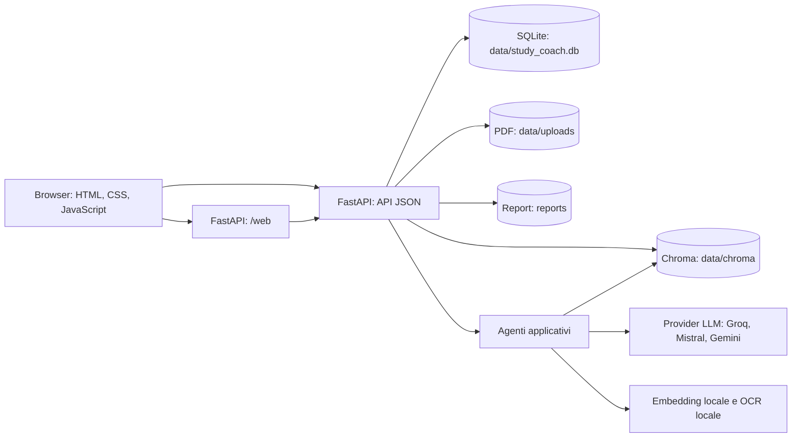
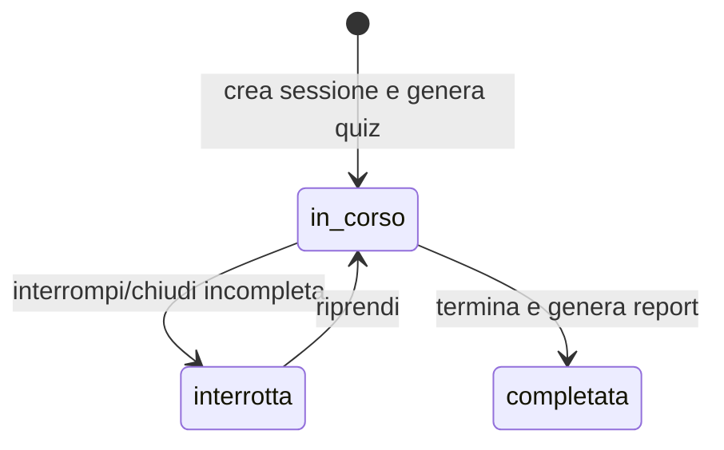
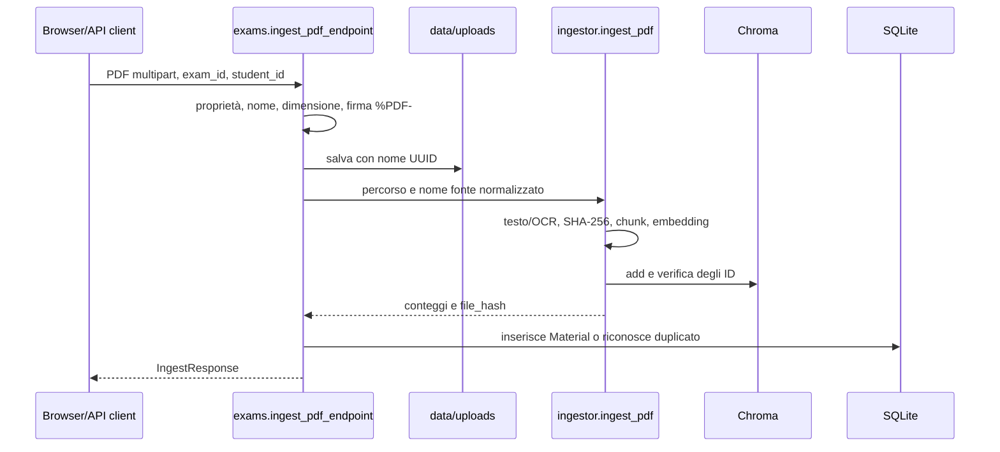
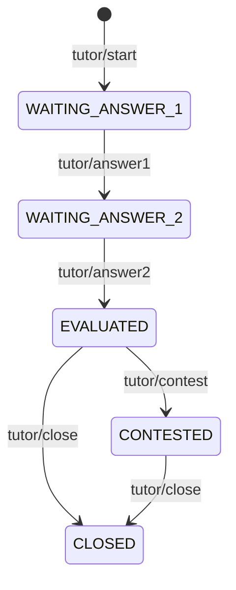
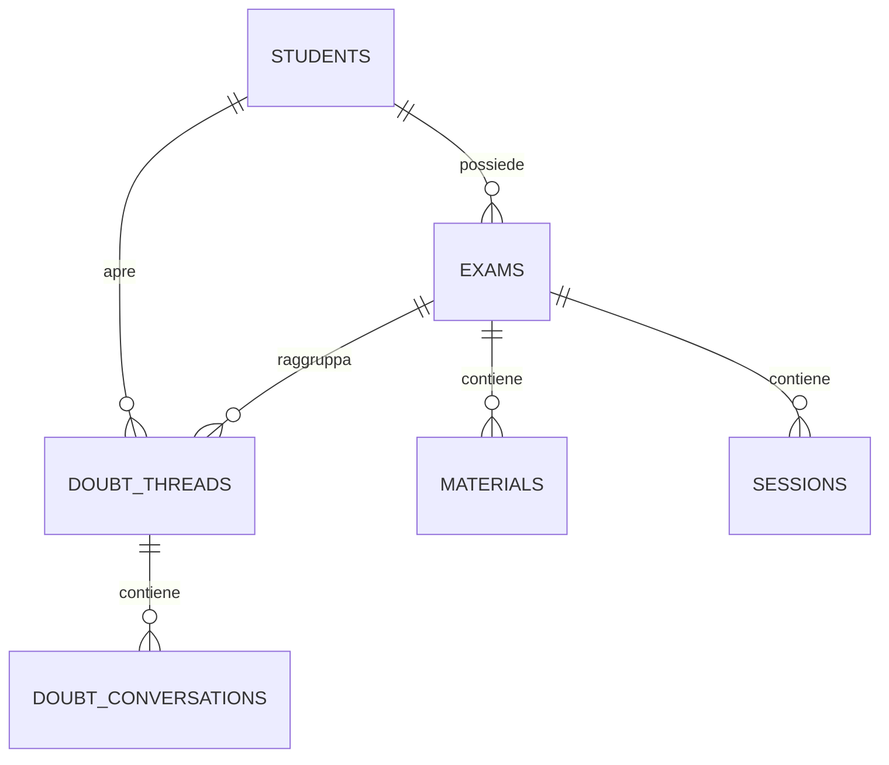

# StudyCoach — relazione tecnica dettagliata

Questa documentazione descrive l'architettura e il funzionamento di StudyCoach. I percorsi indicati sono relativi alla root del progetto. Le istruzioni per installare e avviare l'applicazione sono raccolte in [AVVIO.md](AVVIO.md).

## Indice

1. [Scopo e funzionalità](#1-scopo-e-funzionalità)
2. [Architettura in sintesi](#2-architettura-in-sintesi)
3. [Requisiti e avvio](#3-requisiti-e-avvio)
4. [Persistenza e modello dati](#4-persistenza-e-modello-dati)
5. [Flusso dei PDF e delle fonti](#5-flusso-dei-pdf-e-delle-fonti)
6. [Generazione del quiz](#6-generazione-del-quiz)
7. [Sessione di studio e tutor](#7-sessione-di-studio-e-tutor)
8. [Appunti e chat dei dubbi](#8-appunti-e-chat-dei-dubbi)
9. [Interfaccia e API](#9-interfaccia-e-api)
10. [Autenticazione e sicurezza](#10-autenticazione-e-sicurezza)
11. [Osservabilità e gestione errori](#11-osservabilità-e-gestione-errori)
12. [Test e valutazione](#12-test-e-valutazione)
13. [Procedure operative e recupero](#13-procedure-operative-e-recupero)
14. [Limiti tecnici e punti di estensione](#14-limiti-tecnici-e-punti-di-estensione)
15. [Guida alle modifiche](#15-guida-alle-modifiche)
16. [Analisi dettagliata dei livelli](#16-analisi-dettagliata-dei-livelli)
17. [Contratti HTTP e flussi completi](#17-contratti-http-e-flussi-completi)
18. [Algoritmi e dati persistiti](#18-algoritmi-e-dati-persistiti)
19. [Errori, consistenza e recupero](#19-errori-consistenza-e-recupero)
20. [Qualità, verifica e limiti delle evidenze](#20-qualità-verifica-e-limiti-delle-evidenze)

## 1. Scopo e funzionalità

StudyCoach è un'applicazione di studio per esami universitari. Uno studente crea un account e uno o più esami, carica PDF, sceglie le fonti da usare e genera un quiz basato sui passaggi indicizzati. Durante la sessione risponde a una domanda, riceve una domanda guida socratica, risponde di nuovo, ottiene una valutazione e può contestarla. L'app sceglie le domande successive usando gli argomenti deboli. Produce report e appunti PDF. Una chat separata aiuta ad affrontare dubbi sul materiale dell'esame.

La generazione e la valutazione usano modelli linguistici remoti; gli embedding dei PDF e l'OCR sono locali. Le risposte del modello sono sottoposte a controlli applicativi, ma non costituiscono una valutazione docente garantita.

## 2. Architettura in sintesi

È un monolite Python. `backend/api/main.py` costruisce l'app FastAPI, monta i router API e il router web, serve `frontend/static` e inizializza il DB all'avvio. `frontend/web.py` rende i template Jinja e coordina i form del browser richiamando i servizi applicativi. Non sono necessari Node, npm o un server frontend distinto. Il browser accede normalmente allo stesso host dell'API; `CORS_ORIGINS` serve per eventuali client esterni.

### Percorsi principali

| Percorso | Responsabilità |
|---|---|
| `backend/api/main.py` | App, lifespan, CORS, middleware, router, health check. |
| `backend/api/auth.py`, `authorization.py` | Registrazione, login, logout e controllo del proprietario delle risorse. |
| `backend/api/exams.py`, `frontend_extras.py` | Esami, upload, fonti, verifica, reindicizzazione, appunti, dubbi. |
| `backend/api/sessions.py`, `session_extras.py` | Quiz, tutor, valutazione, sessioni, report, ripresa, appunti da sessione. |
| `frontend/web.py`, `frontend/templates/`, `frontend/static/` | Interfaccia HTML/Jinja, stili, form, avanzamento operazioni e timer. |
| `backend/db/models.py` | Modelli SQLAlchemy, connessione SQLite, creazione e aggiornamento compatibile delle colonne. |
| `backend/agents/ingestor.py` | Lettura PDF, OCR, chunk, embedding, Chroma, retrieval e verifica di coerenza. |
| `backend/agents/quiz_generator.py` | Generazione di quiz con controllo delle citazioni. |
| `backend/agents/socratic_tutor.py` | Loop socratico, valutazione, contestazione e tutor dei dubbi. |
| `backend/agents/notes_generator.py` | Appunti, verifica rispetto alle fonti e impaginazione PDF. |
| `backend/agents/adaptive_engine.py` | Priorità delle domande e statistiche per argomento. |
| `backend/agents/report_generator.py` | Report Markdown/PDF e gestione dei file generati. |
| `backend/agents/model_router.py`, `llm_errors.py` | Scelta provider/modello, errori, timeout e tentativi. |
| `backend/agents/prompts/` | Versioni testuali dei prompt per quiz, tutor e appunti. |
| `backend/models/schemas.py` | Schemi Pydantic di richiesta e risposta. |
| `eval/` | Casi di validazione real LLM, materiali di riferimento e risultati storici. |
| `test/` | Test unitari e di integrazione. |

## 3. Requisiti e avvio

StudyCoach richiede Python **3.13 o successivo**, `uv`, spazio per database, PDF, indice Chroma e cache del modello di embedding. Il primo download del modello e le richieste ai provider LLM richiedono una connessione di rete. La procedura di installazione, la configurazione delle chiavi e l'avvio sono descritti esclusivamente in [AVVIO.md](AVVIO.md).

L'interfaccia è servita dalla stessa applicazione FastAPI. La documentazione interattiva delle API è disponibile su `/docs` e `/redoc`; `/health` restituisce lo stato basilare del processo. All'avvio `init_db()` crea le tabelle mancanti e aggiunge alcune colonne necessarie ai database esistenti.

### Configurazione

`backend/__init__.py` carica prima `.env` senza sovrascrivere l'ambiente di processo, poi applica i valori di `config/app.toml` con `os.environ.setdefault`. **Precedenza:** variabili già presenti nel processo, valori di `.env`, valori di `config/app.toml`. `.env.example` contiene soltanto `GROQ_API_KEY`, `MISTRAL_API_KEY` e `GEMINI_API_KEY`. `model_router.py` accetta anche `GOOGLE_API_KEY` come alternativa per Google. Non salvare chiavi reali nel repository.

| Gruppo | Impostazioni principali | Uso |
|---|---|---|
| Modelli | `TUTOR_PROVIDER/MODEL`, `QUIZ_PROVIDER/MODEL`, `QUIZ_FALLBACK_PROVIDER/MODEL`, `NOTES_PROVIDER/MODEL`, `NOTES_FALLBACK_PROVIDER/MODEL` | Scelta per funzionalità. I valori correnti sono in `config/app.toml`. |
| Chiamate LLM | `LLM_MAX_ATTEMPTS`, `LLM_TIMEOUT_SECONDS`, `LLM_RETRY_BASE_SECONDS` | Tentativi, timeout e attesa. |
| PDF/RAG | `MAX_UPLOAD_BYTES`, `RAG_CHUNK_WORDS`, `RAG_CHUNK_OVERLAP_WORDS`, `RETRIEVAL_MAX_DISTANCE` | Limiti upload, suddivisione e filtro opzionale della distanza. |
| Quiz | `QUIZ_MAX_CONTEXT_CHARS`, `QUIZ_MAX_BATCHES`, `QUIZ_MAX_INVALID_ATTEMPTS`, `QUIZ_MAX_RECOVERY_CALLS` | Limiti della generazione. |
| Appunti | `NOTES_MAX_*` | Tentativi, contesto, chunk e token della generazione/verifica. |
| HTTP | `CORS_ORIGINS` | Origini aggiuntive separate da virgola. |

Cambiare dimensione o sovrapposizione dei chunk richiede reindicizzare le fonti. L'identificatore `LocalEmbeddingFunction.name()` è mantenuto per compatibilità Chroma; il modello effettivo è registrato nei metadati della collection. Non rinominarlo per una semplice modifica della configurazione.

## 4. Persistenza e modello dati

Il DB è SQLite in `data/study_coach.db`. SQLAlchemy definisce:

| Tabella | Contenuto essenziale |
|---|---|
| `students` | Username, email, hash password, hash del token di sessione e scadenza. |
| `login_attempts` | Contatori e finestra temporale del limite sui tentativi di accesso. |
| `exams` | Esami appartenenti a uno studente. |
| `materials` | PDF caricati: percorso, nome, SHA-256, numero pagine, pagine con testo/scartate, numero chunk. |
| `sessions` | Esame/studente, stato, tempi, voto, quiz JSON, turno corrente JSON, log delle risposte JSON, percorso del report. |
| `doubt_threads` | Conversazioni di dubbi raggruppate per esame. |
| `doubt_conversations` | Dubbio, domanda guida, risposta studente e risultato. |

Le relazioni principali sono `Student -> Exam -> Material/Session/DoubtThread/DoubtConversation`. Le foreign key SQLite sono attivate sulla connessione. L'indice vettoriale è separato dal DB relazionale e persiste in `data/chroma`, con una collection `student_<id>_exam_<id>`. I file sorgente risiedono in `data/uploads`; i report in `reports/`. Questi percorsi sono esclusi da Git. Il salvataggio complessivo richiede quindi un backup coerente di **SQLite, PDF, Chroma e report**; copiare soltanto il DB non basta.

`alembic/env.py` collega i metadati SQLAlchemy, ma il progetto non contiene revisioni Alembic. L'evoluzione attuale delle tabelle è gestita soprattutto dalle funzioni `_ensure_*` di `backend/db/models.py` eseguite da `init_db()`; questa soluzione richiede attenzione nelle distribuzioni e nei ripristini complessi.

## 5. Flusso dei PDF e delle fonti

1. L'utente carica un PDF sotto un esame. Gli endpoint controllano proprietà dell'esame, estensione/dimensione e duplicati; il limite predefinito è 25 MiB (`MAX_UPLOAD_BYTES`).
2. `ingest_pdf()` calcola SHA-256 dei byte, apre il PDF con `pypdf`, estrae testo per pagina e usa OCR locale (`pypdfium2` e `rapidocr`) per le pagine senza testo estraibile.
3. Il testo viene diviso in chunk con sovrapposizione. I chunk troppo brevi sono esclusi. Ogni record Chroma contiene testo, studente, esame, pagina, nome fonte e hash del file. L'ID contiene hash, pagina e indice del chunk.
4. Gli embedding sono calcolati localmente con `sentence-transformers/paraphrase-multilingual-MiniLM-L12-v2` e inseriti nella collection dell'esame. Il modello viene caricato al primo utilizzo; il primo download può essere lento.
5. L'ingestione verifica gli ID effettivamente salvati e prova a rimuovere inserimenti parziali in caso di errore. I metadati del materiale vengono registrati in SQLite.
6. Prima di alcune operazioni `verify_exam_material()` confronta file presenti, hash, conteggio chunk in DB e Chroma e segnala anche chunk orfani quando verifica tutto l'esame. Il reindex riparte dai PDF conservati su disco e tenta di ripristinare i vecchi record Chroma se fallisce.

`material_ids` limita l'elaborazione ai materiali scelti. Il retrieval traduce gli ID in filtri Chroma su `file_hash`, con fallback per vecchi record basato sul nome della fonte. La selezione viene salvata in `sessions.quiz_json["material_ids"]` e ripresa dal tutor e dagli appunti generati dal log della sessione. L'isolamento per esame deriva sia dalla collection distinta sia dai controlli di proprietà negli endpoint.

`search_passages()` restituisce testo, fonte, pagina, ID e distanza per la ricerca semantica; `retrieve_passages()` legge i passaggi indicizzati in ordine di documento. `RETRIEVAL_MAX_DISTANCE` può filtrare i risultati della ricerca. Una ricerca vettoriale resta una misura di somiglianza, non una prova automatica di correttezza della risposta.

## 6. Generazione del quiz

`POST /sessions/{session_id}/quiz` verifica i materiali e chiama `generate_quiz()`. Il generatore raccoglie passaggi dalle fonti selezionate, costruisce gruppi con un limite di contesto e richiede un output strutturato al modello. Valida schema e citazione `source_quote` contro il testo effettivamente indicizzato, elimina domande duplicate e prova un recupero limitato se alcuni gruppi falliscono. Il provider principale del quiz e l'eventuale fallback sono configurabili. Se non ottiene il numero richiesto di domande verificabili, l'endpoint risponde con errore e non salva un quiz incompleto come valido.

Il quiz riuscito viene serializzato in `sessions.quiz_json` insieme agli ID delle fonti selezionate. Le domande hanno ID, testo, difficoltà (`base`, `intermedia`, `avanzata`) e `topic_hint`. I prompt sono versionati in `backend/agents/prompts/`; la risposta API include `prompt_version`.

## 7. Sessione di studio e tutor

La sessione salva `started_at`, `active_started_at` e `duration_seconds`. `backend/session_clock.py` accumula il tempo attivo durante pausa, ripresa e completamento; il browser mostra il timer con `frontend/static/session-timer.js`. `current_turn_json` permette di ricostruire il turno del tutor dopo una richiesta o un riavvio; `qa_log` conserva i tentativi già chiusi.

Per una domanda il tutor carica passaggi RAG delle fonti selezionate, riceve la prima risposta, formula una domanda guida e valuta la seconda risposta su scala 0–10. Restituisce motivazione, punti corretti, lacune e indicazione del miglioramento. Lo studente può inviare una contestazione motivata prima della chiusura della domanda. Lo stato del turno è serializzato tramite `SocraticTutor.to_json()`; il server ricostruisce il tutor da `current_turn_json` quando necessario. I moduli `quality_controls.py` ed `evaluation_validator.py` controllano struttura, coerenza e casi di risposte prive di contenuto.

`AdaptiveEngine` registra gli esiti affidabili e sceglie prima domande di argomenti deboli, poi argomenti non ancora affrontati, poi la prima domanda rimasta. I voti numerici con `reliable=False` possono comparire nella media/report storico, mentre la selezione adattiva li esclude. La distinzione evita che una valutazione dichiarata inaffidabile orienti il percorso successivo.

Alla chiusura, il report contiene media, numero di domande, dettaglio per argomento e sintesi. `report_generator.py` crea Markdown e PDF in `reports/` e salva il percorso del PDF nella sessione. Gli endpoint permettono download e rigenerazione del report a partire dal log, quando è disponibile un voto finale. Il PDF è una fotografia dei dati di sessione, non la fonte primaria: i dati primari sono nel DB.

## 8. Appunti e chat dei dubbi

Gli appunti d'esame si possono generare da una o più fonti come PDF (`POST /exams/{exam_id}/notes/pdf`). Il generatore legge i passaggi indicizzati e divide il lavoro in parti. Per ogni parte, un Team Agno in modalità `coordinate` affida la stesura a un agente e la verifica di fedeltà a un altro; il leader restituisce gli appunti finali. Un ulteriore controllo applicativo verifica struttura e fedeltà prima dell'impaginazione con `fpdf2` e font Unicode inclusi nel repository. La UI mostra l'avanzamento delle fasi e propone il download solo dopo la generazione completa. Esiste anche una risposta testuale per gli appunti d'esame e un endpoint che produce appunti dal `qa_log` di una sessione, arricchiti con retrieval limitato alle fonti del quiz. Quest'ultimo percorso usa ancora il singolo agente di scrittura.

La chat dei dubbi è distinta dalla sessione quiz. Un dubbio viene salvato in un thread per esame; `DoubtTutor` cerca il materiale pertinente e formula una domanda guida. La risposta dello studente viene poi valutata e persistita in `doubt_conversations`. L'interfaccia espone la cronologia. Un dubbio aperto nello stesso thread va risolto o scartato prima di iniziarne un altro.

## 9. Interfaccia e API

La UI è server side: template Jinja in `frontend/templates/`, CSS e JS in `frontend/static/`. Le pagine coprono autenticazione, libreria esami, dettaglio esame/fonti, studio, chat e cronologia. Alcune operazioni lunghe usano risposte streaming per aggiornare l'avanzamento nel browser. `frontend/web.py` gestisce redirect e messaggi di errore dei form; le rotte web sono sotto `/web` e non compaiono nello schema OpenAPI.

Le rotte JSON principali sono:

| Prefisso | Azioni |
|---|---|
| `/auth` | Registrazione, login, utente corrente, logout. |
| `/exams` | Lista, creazione, eliminazione, caricamento/eliminazione PDF. |
| `/exams/{exam_id}` | Rinomina, elenco/verifica/reindex materiali, appunti, dubbi e cronologia chat. |
| `/sessions` | Creazione e lista sessioni. |
| `/sessions/{session_id}` | Quiz, tutor, scelta domanda, pausa/ripresa, chiusura, report e appunti. |
| `/health` | Controllo HTTP basilare. |

Le forme complete di payload, status e route sono definite negli schemi Pydantic e in `/docs`. La maggior parte delle rotte API richiede `student_id` come query parameter, coerente con il proprietario autenticato; le risorse altrui vengono nascoste con risposta 404. Non assumere che conoscere un ID autorizzi la lettura.

## 10. Autenticazione e sicurezza

Le password sono verificate con bcrypt. Login e registrazione rilasciano un token casuale; il browser lo conserva nel cookie `sc_token`, mentre il server salva un digest e una scadenza di sette giorni. Le API accettano cookie o `Authorization: Bearer <token>`. Il logout invalida il token lato server. `authorization.py` controlla studente, esame e sessione prima di eseguire gli handler. Il login ha un limite di tentativi per account e origine, registrato in SQLite.

Il middleware controlla l'header `Origin` per i POST sotto `/web/` e respinge origini diverse dall'host della richiesta. La configurazione CORS non abilita automaticamente origini esterne: la lista predefinita è vuota. `security.py` normalizza i nomi di file; i messaggi pubblici degli errori passano per funzioni che evitano di esporre dettagli tecnici o chiavi API. L'esposizione in rete pubblica richiede inoltre TLS, gestione dei backup, protezione dei segreti e procedure operative adeguate.

## 11. Osservabilità e gestione errori

Ogni risposta gestita dal middleware HTTP include `X-Request-ID`. `backend/observability.py` usa l'ID nel contesto della richiesta e registra stadi come HTTP, retrieval e chiamate al modello con tempi ed esiti. I log non dovrebbero contenere prompt integrali, risposte degli studenti o brani dei PDF. Il codice distingue limiti quota/rate limit, errori temporanei del provider, PDF non leggibili, indice mancante e materiali incoerenti; la UI mostra messaggi orientati al recupero. `/health` prova soltanto che il processo risponde: non verifica DB, Chroma o provider esterni.

## 12. Test e valutazione

Pytest esclude per impostazione predefinita i test marcati `real_llm`; questi richiedono credenziali e possono consumare quota. I test in `test/` coprono autenticazione, proprietà delle risorse, API/UI, ingestione, sorgenti, quiz, tutor, valutazione, sessioni, tempo, report, note, configurazione e osservabilità. Test con embedding o provider simulati verificano logica e isolamento, non la qualità della ricerca semantica o del modello in produzione.

Il runner `eval/run_eval.py` controlla schema e hash dei casi di validazione. L'esecuzione con Groq richiede `GROQ_API_KEY`, salva risultati JSON/Markdown in `eval/results/` e misura, tra l'altro, voto e citazioni. Il runner invia il testo di riferimento completo a Groq e **non attraversa il retrieval dell'applicazione**: i suoi risultati non dimostrano da soli l'affidabilità end to end del flusso PDF → Chroma → tutor. I risultati già presenti in `eval/results/` descrivono le esecuzioni in cui sono stati prodotti.

## 13. Procedure operative e recupero

| Sintomo | Controllo e azione |
|---|---|
| Il server non parte | Verificare versione Python, dipendenze, traceback completo e presenza di `config/app.toml`. |
| Il primo caricamento PDF sembra lento | Attendere download/cache del modello di embedding e OCR delle pagine senza testo. |
| Materiale incoerente | Usare la verifica dell'esame, controllare file in `data/uploads`, hash e conteggi; reindicizzare dal PDF originale. |
| Sono cambiati i parametri di chunking | Reindicizzare le fonti; i vecchi chunk mantengono i vecchi confini finché non sono ricreati. |
| Quota o timeout LLM | Verificare provider, modello, chiave e tempi comunicati dall'errore; riprovare dopo l'intervallo indicato. |
| Report mancante | Se la sessione ha voto e log valutato, usare la rigenerazione del report. |
| Ripristino da backup | Ripristinare insieme DB, PDF, indice Chroma e report; poi verificare materiali ed eseguire i flussi essenziali. |

La cancellazione di fonti o esami coinvolge più store (SQLite, file e Chroma). I moduli `materials.py` ed `exam_deletion.py` implementano pulizia e recupero in caso di errori; non esiste però una transazione distribuita atomica fra questi sistemi. Dopo un'interruzione del processo durante una modifica, usare la verifica dei materiali prima di generare nuovo contenuto.

## 14. Limiti tecnici e punti di estensione

La correttezza disciplinare delle domande, dei giudizi e degli appunti dipende dalla qualità del PDF, dall'estrazione, dal retrieval e dal modello remoto. Una citazione letterale prova che il brano esiste nel testo indicizzato; non prova automaticamente che la domanda sia didatticamente valida. SQLite e Chroma sono locali: l'assetto corrente è pensato per una singola installazione, non per più processi con storage indipendente. Le operazioni PDF e LLM sono eseguite durante richieste HTTP; per carichi elevati occorre una coda di job persistenti. La migrazione delle tabelle usa principalmente funzioni `_ensure_*` in `backend/db/models.py`: esiste la configurazione Alembic, ma non una serie di revisioni versionate.

## 15. Guida alle modifiche

Le modifiche ai flussi partono dal router in `backend/api/` o `frontend/web.py` e proseguono nel servizio in `backend/agents/`, negli schemi di `backend/models/schemas.py` e nella persistenza di `backend/db/models.py`. Un cambiamento del formato JSON salvato nelle sessioni deve mantenere la lettura dei dati storici. Un cambiamento a chunking o modello di embedding richiede reindex e verifica Chroma. I test devono coprire casi positivi, negativi, proprietà delle risorse e fallimenti di persistenza, oltre alla regressione completa.

## 16. Analisi dettagliata dei livelli

### 16.1 Processo e ordine di inizializzazione

L'import di `backend` esegue `backend/__init__.py`: legge `.env` senza sovrascrivere l'ambiente di processo, apre `config/app.toml`, controlla che i nomi siano maiuscoli e i valori siano scalari, quindi applica i default con `os.environ.setdefault`. Alcune costanti nei moduli leggono l'ambiente al momento dell'import: dopo un cambio di configurazione è quindi opportuno riavviare il processo. `backend/api/main.py` costruisce l'app FastAPI, monta i router e gli asset e nel lifespan richiama `init_db()` prima di dichiarare il server pronto.

Il middleware di tracing crea un ID per richiesta, misura la durata e aggiunge `X-Request-ID` alle risposte gestite. Il middleware dei form controlla `Origin` se presente sui POST `/web/`. FastAPI esegue molte funzioni sincrone in threadpool; il router web usa anche `run_in_threadpool` e `asyncio.to_thread` per parsing, retrieval e generazione. Questo evita di occupare il loop asincrono, ma non fornisce una coda di lavoro durevole. `/health` verifica soltanto che il processo HTTP risponde; non apre Chroma né chiama provider esterni.

### 16.2 Confine tra browser, API e servizi

`frontend/web.py` è l'adattatore browser. Riceve form, identifica lo studente dal cookie, verifica l'esame o la sessione, richiama funzioni di `backend/api/` e rende una pagina Jinja oppure restituisce un redirect. Le rotte web sono escluse dallo schema OpenAPI. Gli endpoint JSON usano Pydantic per validare payload e risposte. Le pagine HTML non sono la fonte primaria dello stato: dopo refresh o redirect rileggono SQLite.

I template sono `base.html`, `auth.html`, `exams.html`, `exam.html`, `setup.html`, `study.html`, `chat.html`, `chat_history.html` e `history.html`. Gli asset JavaScript gestiscono timer, invio chat e avanzamento delle operazioni. Quando il browser invia `Accept: application/x-ndjson`, `_operation_stream()` produce eventi `progress`, `complete` ed `error`, più heartbeat circa ogni 15 secondi. `complete` contiene un URL di destinazione. `_notes_stream()` invia anche il PDF finale in base64 e il Markdown degli appunti; senza tale header, il form segue il percorso ordinario. Lo stream è legato alla connessione HTTP e non equivale a un job recuperabile dopo chiusura del browser.

### 16.3 Moduli di dominio

`ingestor.py` possiede lettura PDF, OCR, chunk, embedding, collection Chroma, ricerca e verifica delle fonti. `quiz_generator.py` legge passaggi indicizzati e produce domande fondate. `socratic_tutor.py` mantiene la macchina a stati del turno e il tutor dei dubbi. `evaluation_validator.py` e `quality_controls.py` applicano regole deterministiche alle risposte del modello. `adaptive_engine.py` sceglie le domande e calcola statistiche. `notes_generator.py` costruisce appunti e PDF; `report_generator.py` costruisce report Markdown/PDF. `model_router.py` sceglie provider e modello per funzionalità; `llm_errors.py` classifica errori riprovabili e limiti quota.

I prompt sono file versionati in `backend/agents/prompts/`. Cambiare il contenuto di un prompt mantenendo la stessa versione rende meno interpretabili i risultati storici. La versione del prompt del quiz è salvata nel risultato. `materials.py` ed `exam_deletion.py` coordinano modifiche fra più store; `security.py`, `session_cookie.py` e `login_limiter.py` gestiscono credenziali, cookie e tentativi di accesso.

### 16.4 Dipendenze e ruolo

| Tecnologia | Uso concreto |
|---|---|
| FastAPI, Uvicorn, Starlette | Server ASGI, routing, middleware, streaming e file statici. |
| Jinja2, MarkdownIt, MarkupSafe | Pagine HTML e rendering degli appunti nella cronologia. |
| SQLAlchemy, SQLite | Dati relazionali e transazioni locali. |
| ChromaDB, sentence-transformers | Indice vettoriale persistente ed embedding locale. |
| pypdf, pypdfium2, RapidOCR, NumPy | Estrazione PDF, rendering pagine e OCR. |
| Agno e SDK provider | Chiamate a Groq, Mistral e Gemini. |
| fpdf2 e font inclusi | Creazione di report e appunti PDF. |
| bcrypt | Hash e verifica password. |
| pytest e httpx | Test automatici dell'extra `dev`. |

Le versioni esatte sono bloccate in `pyproject.toml` e `uv.lock`.

## 17. Contratti HTTP e flussi completi

### 17.1 Catalogo delle API JSON

Questa tabella è una mappa per la manutenzione. Per parametri e schemi completi consultare `/docs` e `backend/models/schemas.py`. Le rotte di esami e sessioni richiedono autenticazione e controllo del proprietario; quando previsto, `student_id` in query deve coincidere con il token.

| Metodo e percorso | Effetto principale | Modulo |
|---|---|---|
| `POST /auth/register`, `POST /auth/login` | Crea account o autentica e imposta cookie. | `api/auth.py` |
| `GET /auth/me`, `POST /auth/logout` | Identità corrente e revoca credenziale. | `api/auth.py` |
| `GET /exams`, `POST /exams`, `DELETE /exams/{exam_id}` | Lista, creazione, cancellazione. | `api/exams.py` |
| `POST /exams/{exam_id}/ingest` | Upload e indicizzazione multipart. | `api/exams.py` |
| `DELETE /exams/{exam_id}/materials/{material_id}` | Cancellazione fonte. | `api/exams.py` |
| `GET /exams/{exam_id}/materials`, `PATCH /exams/{exam_id}` | Lista fonti e rinomina esame. | `api/frontend_extras.py` |
| `POST /exams/{exam_id}/verify`, `/reindex` | Verifica integrità e ricostruzione indice. | `api/frontend_extras.py` |
| `POST /exams/{exam_id}/notes`, `/notes/pdf` | Appunti testuali o PDF. | `api/frontend_extras.py` |
| `POST /exams/{exam_id}/doubts` | Apre dubbio e domanda guida. | `api/frontend_extras.py` |
| `POST /exams/{exam_id}/doubts/{conversation_id}/answer` | Valuta risposta al dubbio. | `api/frontend_extras.py` |
| `DELETE /exams/{exam_id}/doubts/{conversation_id}` | Scarta dubbio. | `api/frontend_extras.py` |
| `POST /sessions`, `GET /sessions` | Crea sessione o elenca quelle di un esame. | `api/sessions.py` |
| `POST /sessions/{session_id}/quiz` | Genera e salva quiz. | `api/sessions.py` |
| `POST /sessions/{session_id}/tutor/start` | Avvia turno con una domanda canonica. | `api/sessions.py` |
| `POST /sessions/{session_id}/tutor/answer1`, `/answer2` | Domanda guida e valutazione. | `api/sessions.py` |
| `POST /sessions/{session_id}/tutor/contest`, `/close` | Contestazione e chiusura turno. | `api/sessions.py` |
| `POST /sessions/{session_id}/next-question`, `/close` | Scelta adattiva e report. | `api/sessions.py` |
| `GET /sessions/{session_id}`, `/resume`, `/detail` | Stato sintetico e ricostruito. | `api/sessions.py`, `api/session_extras.py` |
| `POST /sessions/{session_id}/interrupt`, `/resume-active`, `/mark-complete` | Lifecycle di una sessione incompleta. | `api/session_extras.py` |
| `POST /sessions/{session_id}/timer` | Tempo attivo. | `api/session_extras.py` |
| `DELETE /sessions/{session_id}` | Elimina sessione non completata. | `api/session_extras.py` |
| `POST /sessions/{session_id}/notes` | Appunti dal log. | `api/session_extras.py` |
| `GET /sessions/{session_id}/report`, `POST /sessions/{session_id}/report/regenerate` | Download e rigenerazione. | `api/session_extras.py` |

### 17.2 Registrazione, login e accesso alle risorse

`RegisterRequest` impone username di 3–50 caratteri, email formalmente valida, password di almeno 6 caratteri e conferma uguale; la password è limitata a 72 byte UTF-8 per bcrypt. Il server salva hash password, non la password. `auth.login()` verifica le credenziali e consulta il limite dei tentativi di accesso registrato in `login_attempts`. Il token casuale è consegnato tramite cookie; nel DB viene salvato il suo digest e una scadenza di sette giorni. Le API accettano il cookie oppure `Authorization: Bearer <token>`. `authorization.py` ricava il proprietario, verifica `student_id` e le relazioni esame/sessione prima dell'handler. L'accesso a una risorsa altrui restituisce 404 per non confermarne l'esistenza.

### 17.3 Upload di un PDF: sequenza e compensazioni

L'endpoint legge al massimo `MAX_UPLOAD_BYTES + 1` byte, così non alloca un upload illimitato. Controlla estensione `.pdf` e firma iniziale `%PDF-`; un file oltre limite produce 413. Il file persistito ha nome UUID e il nome originale, normalizzato da `safe_name()`, resta nei metadati. L'ingestor calcola SHA-256 dei byte, usa `pypdf` per estrazione testo pagina per pagina e RapidOCR sulle sole pagine senza testo. Tiene distinti pagine totali, con testo, scartate e OCR. Rifiuta PDF protetti/corrotti, senza testo utilizzabile o senza chunk validi.

I chunk vengono inseriti in batch da 100 e gli ID effettivamente presenti vengono confrontati con quelli attesi. Se l'inserimento fallisce, il codice prova a cancellare i chunk parziali. Se il DB non riesce a salvare `Material`, la routine di rollback dell'ingestione cancella i chunk nuovi **solo se** nessun materiale già registrato possiede lo stesso hash. Se invece un PDF identico era già presente nell'esame, il nuovo file viene eliminato e il record esistente resta. Questi passaggi sono compensazioni fra sistemi separati, non una transazione atomica comune.

### 17.4 Dalla selezione delle fonti al quiz

Il browser invia gli ID delle fonti dell'esame. `_selected_materials()` verifica che tutti appartengano allo stesso esame e `verify_exam_material()` confronta file, hash e chunk. La UI ammette da 3 a 10 domande, mentre lo schema JSON di `QuizGenerateRequest` ammette da 1 a 20: il limite web è più stretto. `_start_study_work()` crea una sessione, genera il quiz e avvia la prima domanda. Se questa sequenza web fallisce dopo la creazione, cancella la sessione incompleta. Un client che usa direttamente le API gestisce invece creazione e quiz come operazioni separate.

`create_session()` salva stato `in_corso`, inizio e tempo attivo. `generate_session_quiz()` riverifica le fonti, genera esattamente il numero richiesto di domande e salva in `quiz_json` il risultato e gli eventuali `material_ids`. `tutor_start()` accetta solo una domanda uguale a quella canonica persistita e rifiuta domande già chiuse o un secondo turno aperto.

### 17.5 Macchina a stati di una domanda

`answer1` salva il testo della prima risposta **prima** di chiamare il modello per la domanda guida. `answer2` salva la seconda risposta prima della valutazione. Se la chiamata LLM fallisce, il testo inviato rimane nel turno persistito. A successo vengono salvati domanda guida, feedback, voto e motivazione. Dopo ogni richiesta il tutor viene ricostruito da `current_turn_json` e recupera di nuovo il contesto Chroma delle fonti selezionate. Gli stati sono definiti nell'enum `TurnState` di `socratic_tutor.py`.

La valutazione può richiedere due giudizi indipendenti. `_evaluate_one()` valida JSON, coerenza fra voto e punti corretti/mancanti, sufficienza del materiale e contenuto effettivo della risposta. Per un output valido il punteggio viene calcolato tramite `rubric_score()`, poi corretto dai guardrail. Fra due voti affidabili si sceglie il minore; una differenza superiore a un punto marca il risultato `reliable=False`. Un output non validabile dopo i tentativi può essere restituito con voto numerico ma marcato non affidabile; in assenza di materiale sufficiente l'operazione fallisce. La contestazione è opzionale e salva giudizio sulla contestazione, eventuale differenza di voto e risposta allo studente.

`tutor/close` richiede un voto finale. Serializza il tentativo in `qa_log` e cancella `current_turn_json` nella **stessa transazione SQLite**, dopo aver verificato che l'ID della domanda non sia già presente. Questo è il punto in cui un turno diventa una risposta chiusa e conteggiabile.

### 17.6 Sessione, tempo, adattamento e report

`next-question` ricava le domande rimanenti dal quiz e dal `qa_log` salvati, anziché fidarsi della lista inviata dal client. Ricostruisce `AdaptiveEngine` escludendo i tentativi inaffidabili, poi sceglie nell'ordine un argomento debole, un argomento non ancora trattato oppure la prima domanda rimasta. `close_session()` ricostruisce l'engine includendo i voti numerici anche se marcati non affidabili, richiede almeno una risposta valutata e crea report Markdown/PDF. Aggiorna voto finale, percorso PDF, fine, durata e stato `completata` in SQLite. Se il salvataggio nel DB fallisce, tenta di ripristinare la precedente versione dei file del report.

`interrupt` congela il tempo e passa a `interrotta` conservando quiz, turno e log. `resume-active` riporta una sessione riprendibile a `in_corso` e riavvia il cronometro. `mark-complete` chiude un'incompleta senza voto finale, conservando lo stato `interrotta`. La cancellazione è consentita soltanto se non è completata e `score_total` è nullo. `GET /sessions/{id}/resume` restituisce quiz, turno parziale e statistiche adattive ricostruite.

### 17.7 Chat dei dubbi e appunti

La chat dei dubbi non risponde subito con una soluzione libera. `start_doubt()` cerca passaggi pertinenti, chiede al `DoubtTutor` una domanda guida e salva una `DoubtConversation` in un thread. Un dubbio già aperto nello stesso thread deve essere risolto o scartato; se la richiesta è identica, viene riusato il record aperto. `answer_doubt()` ricostruisce il tutor, ricerca di nuovo i passaggi e salva risposta e valutazione nel record. La UI permette più thread, cronologia ed eliminazione di un thread.

Per gli appunti PDF, `generate_notes_pdf_from_materials()` legge i passaggi di ogni fonte scelta e produce sezioni distinte. `_notes_from_passages()` lavora per parti e avvia `NotesTeam`: il leader delega la stesura a `NotesGeneratorAgent`, passa bozza e fonte a `NotesFidelityReviewAgent`, richiede una correzione se il revisore segnala contenuti non supportati e restituisce soltanto il Markdown. Il Team ha un limite alle iterazioni. Il risultato viene accettato soltanto se entrambi i worker hanno completato la loro parte: una risposta del leader da sola non basta. Dopo la risposta del Team, `_verify_notes_fidelity()` esegue un controllo separato: individua i frammenti non sostenuti, rimuove le righe interessate e verifica di nuovo la struttura. Su un errore temporaneo o un limite quota del provider principale, il flusso degli appunti può passare al provider di riserva configurato, mantenendolo per le parti successive della stessa fonte. `generate_notes_from_log()` usa invece le risposte della sessione, individua argomenti deboli e, se richiesto, aggiunge passaggi RAG filtrati dai `material_ids` persistiti nel quiz; non usa `NotesTeam`. Questi controlli riducono errori evidenti, ma gli appunti vanno comunque riesaminati, soprattutto se il PDF contiene formule o OCR imperfetto.

## 18. Algoritmi e dati persistiti

### 18.1 Relazioni e campi di stato

Le chiavi primarie di `students`, `exams`, `materials` e `sessions` sono interi; thread e conversazioni usano UUID testuali. `sessions.student_id` può essere nullo nei dati legacy, mentre la proprietà resta ricostruibile dall'esame. `quiz_json`, `current_turn_json` e `qa_log` sono colonne `TEXT` contenenti JSON, non tabelle normalizzate. Chi cambia il formato deve mantenere una lettura compatibile con le vecchie sessioni. Le date nuove sono UTC; `session_clock.py` tratta timestamp legacy senza timezone come UTC nel calcolo della durata.

| Campo | Scrittura e significato | Lettori |
|---|---|---|
| `materials.file_hash` | SHA-256 dei byte PDF in upload o reindex. | Deduplica, verifica, filtri Chroma e cancellazione. |
| `materials.chunks_count` | Conteggio dei chunk indicizzati. | Verifica di consistenza. |
| `materials.pages_with_text`, `pages_skipped` | Esito estrazione/OCR per pagina. | Interfaccia esame. |
| `sessions.quiz_json` | Domande, versione prompt e `material_ids`. | Tutor, ripresa, scelta domanda e note. |
| `sessions.current_turn_json` | Domanda attiva, risposte, guida, voto e contestazione. | Ripresa del tutor e UI. |
| `sessions.qa_log` | Lista di turni chiusi e voti finali. | Adattamento, report, appunti, cronologia. |
| `sessions.duration_seconds` | Secondi attivi già accumulati. | Timer e cronologia. |
| `sessions.active_started_at` | Inizio del segmento attivo. | Calcolo durata fino a pausa/chiusura. |
| `sessions.score_total` | Media finale della sessione. | Elenco esami e cronologia. |
| `sessions.report_path` | Percorso del PDF finale. | Download e rigenerazione. |

### 18.2 Chunking e identità della fonte

`chunk_text()` divide per parole, preferisce fermarsi a fine frase o paragrafo entro `RAG_CHUNK_WORDS` (default 90) e usa `RAG_CHUNK_OVERLAP_WORDS` (default 15) per sovrapporre il contesto. `_model_safe_chunks()` suddivide ulteriormente un chunk quando supererebbe `max_seq_length` del tokenizer dell'embedder. I pezzi sotto 20 caratteri non vengono indicizzati. Un ID Chroma ha forma `<sha256>_p<pagina>_c<indice>`: l'hash differenzia PDF, la pagina mantiene la provenienza e l'indice identifica il chunk. Gli ID attesi sono ricalcolabili se PDF, modello e parametri di chunking restano invariati.

La collection dell'esame contiene metadati `student_id`, `exam_id`, `embedding_model`; ogni documento contiene pagina, fonte e hash. `get_collection()` confronta il modello di embedding registrato con quello corrente. Se cambia, ricalcola gli embedding dei documenti presenti in batch e poi aggiorna il metadato della collection. Questa conversione riguarda i vettori, non ricrea i confini dei chunk. Il cambio di modello richiede un backup preventivo di `data/chroma` e una verifica dell'indice dopo la conversione.

### 18.3 Ricerca e filtro delle fonti

`retrieve_passages()` legge passaggi indicizzati e li ordina per fonte, pagina e indice. È usato quando serve coprire un documento intero, ma può costare per PDF molto lunghi. `search_passages()` usa la query vettoriale e restituisce testo, fonte, pagina, ID e distanza. `retrieve_chunks()` espone una variante solo testuale. Un `material_ids=[]` produce una lista vuota. Con ID presenti, `_material_where_clause()` verifica l'appartenenza all'esame e costruisce un filtro Chroma basato su `file_hash`. Per record legacy senza hash usa il nome della fonte; fonti omonime in quel caso richiedono reindex per togliere l'ambiguità. `RETRIEVAL_MAX_DISTANCE`, se impostato, filtra i risultati troppo distanti.

### 18.4 Copertura e controllo del quiz

`_quiz_contexts()` attraversa le fonti a rotazione, etichetta ogni passaggio con nome e pagina e costruisce gruppi entro `QUIZ_MAX_CONTEXT_CHARS`. `_select_quiz_contexts()` limita le chiamate mantenendo almeno un gruppo per fonte e scegliendo anche inizio/fine e posizioni distribuite nel documento. Se le fonti distinte superano il normale budget `QUIZ_MAX_BATCHES`, il budget può aumentare per coprirle tutte almeno una volta.

Il modello produce JSON validato da `QuizPayload`. Ogni `source_quote` viene normalizzato per spazi e maiuscole e cercato **dentro un singolo passaggio** del gruppo; una frase inventata o fusa da più brani viene respinta. Un gruppo invalido può ricevere un tentativo correttivo. Il testo delle domande è deduplicato. Se il provider primario raggiunge la quota e c'è un fallback configurato, il generatore può continuare sul provider di riserva. Il recupero delle domande mancanti usa solo contesti che hanno già dato risultati verificabili. Infine l'endpoint rifiuta un quiz che contenga meno domande di quelle richieste, anche se quelle prodotte sono valide.

### 18.5 Calcolo del tempo e dei voti

Il tempo attivo visualizzato è `duration_seconds` accumulato più i secondi trascorsi da `active_started_at` **soltanto se** lo stato è `in_corso`. `pause_clock()` somma il segmento e azzera l'inizio attivo; `resume_clock()` apre un segmento soltanto se non è già aperto. L'adattamento esclude tentativi con `reliable=False` a livello di record o valutazione. Il report storico finale include i voti numerici disponibili anche se marcati non affidabili. Un argomento è debole con media sotto 6, oppure con un solo tentativo sotto 5; un argomento forte ha media almeno 8. Le medie nel report sono arrotondate a una cifra decimale.

## 19. Errori, consistenza e recupero

### 19.1 Confini transazionali

SQLite garantisce atomicità soltanto per le proprie transazioni. File, Chroma e report sono archivi distinti. Per cancellare una fonte, `materials.delete_material()` sposta il PDF in un file temporaneo, conserva i record Chroma da ripristinare, cancella indice e record SQL e conferma la transazione. Su errore tenta di ricreare i chunk e rimettere il PDF al suo posto. Per eliminare un esame, `exam_deletion.delete_exam()` sposta temporaneamente PDF e report, conserva una copia dei dati della collection, la elimina e conferma la transazione nel DB; su errore tenta di ripristinare collection e file. Errori specifici distinguono cancellazione riuscita con pulizia finale incompleta da cancellazione fallita con recupero incompleto.

Il reindex in `frontend_extras.py` opera **una fonte alla volta**: conserva vecchi documenti/metadati, cancella i vecchi chunk, richiama l'ingestor e aggiorna conteggi/hash nel DB. Se una fonte fallisce, tenta di ripristinarne i record Chroma precedenti. Non offre atomicità sull'intero insieme dei materiali dell'esame. Dopo un crash o un'operazione manuale, `verify_exam_material()` è il controllo centrale per individuare file mancanti, hash cambiati, differenze di conteggio e chunk orfani.

### 19.2 Matrice di errori osservabili

| Condizione | Esito tipico | Diagnosi |
|---|---|---|
| Token assente o scaduto | API 401, UI verso login. | Rifare login; controllare cookie o bearer. |
| ID di altro studente | 404. | Verificare proprietario di esame/sessione. |
| POST web con `Origin` estraneo | 403. | Controllare host, schema e proxy. |
| PDF oltre limite | 413. | Confrontare dimensione con `MAX_UPLOAD_BYTES`. |
| Firma o contenuto PDF non valido | 400/422 secondo la fase. | Riesportare il file originale. |
| OCR fallito o nessun testo utile | Upload rifiutato. | Controllare leggibilità delle pagine. |
| File, hash o chunk incoerenti | Verifica `ok=false`; operazioni dipendenti possono dare 409. | Verifica e reindex dal PDF conservato. |
| Quiz con meno domande fondate del richiesto | 422 e quiz non accettato. | Ridurre numero o migliorare fonti. |
| Stato tutor incompatibile | 409. | Ricaricare il dettaglio della sessione. |
| Quota provider | 429 dove mappato o errore pubblico con attesa. | Controllare provider, chiave e retry indicato. |
| Report mancante | Download 404. | Rigenerare dal log se c'è un voto finale. |

I messaggi pubblici passano da `public_error()` o dalle traduzioni nei router; il log server contiene la diagnostica. Per capire un guasto leggere il traceback **completo**, incluso ciò che accade dopo la risposta LLM e prima della persistenza. In una console Windows con encoding limitato, anche un carattere Unicode scritto su stdout può interrompere una richiesta: non attribuire automaticamente il guasto al modello. `X-Request-ID` aiuta a collegare richiesta, retrieval e chiamate al provider nei log.

### 19.3 Backup e ripristino

Un backup coerente comprende `data/study_coach.db`, `data/uploads/`, `data/chroma/` e `reports/`, raccolti quando non ci sono scritture in corso o tramite una procedura che garantisca coerenza. Per riprodurre l'ambiente conservare anche configurazione e prompt versionati; custodire `.env` separatamente. Dopo il ripristino: avviare il server, verificare login e lista esami, usare la verifica materiali su ogni esame, aprire una sessione storica, scaricare un report e provare retrieval su una fonte campione. `/health` da solo non dimostra l'integrità dei dati.

### 19.4 Diagnosi della configurazione LLM

`config/app.toml` sceglie attualmente Groq per il tutor, Mistral per il quiz con Gemini come fallback e Gemini per gli appunti con Groq come riserva. Ogni funzionalità ha una coppia provider/modello indipendente. Cambiare `GROQ_MODEL` non sostituisce un `TUTOR_MODEL` esplicito. `make_model()` richiede la chiave del provider scelto, applica il timeout e configura l'eventuale modalità JSON. `llm_errors.py` classifica limiti e problemi riprovabili e applica un numero finito di tentativi. Quando una funzione non parte, controllare la **sua** coppia provider/modello e la relativa chiave, non soltanto la presenza di una chiave generica.

## 20. Qualità, verifica e limiti delle evidenze

### 20.1 Test automatici

`test/test_*.py` copre schemi, autenticazione, cookie, proprietà API, configurazione, ingestione, controlli di qualità, routing dei modelli, quiz, tutor, adaptive engine, report, timer, appunti, interfaccia e recupero. Alcuni test sostituiscono provider, embedding o indice con fake/monkeypatch per rendere l'esecuzione deterministica: verificano invarianti come filtri, conteggi e rollback, ma non misurano la qualità semantica del modello reale. I test marcati `real_llm` sono esclusi da pytest per impostazione predefinita e richiedono credenziali/quota.

### 20.2 Validazione real LLM

`eval/cases/` contiene casi con riferimento, input, atteso, ottenuto, esito e commento. La modalità di sola validazione di `eval/run_eval.py` verifica schema, presenza dei materiali e hash SHA-256; richiede almeno 24 casi. L'esecuzione con il modello richiede `GROQ_API_KEY` e conserva output JSON e riepilogo Markdown in `eval/results/` con data, modello, versione del prompt, ambiente e risposte grezze. Calcola conteggi, corrispondenza dei voti, errore medio assoluto e citazioni. Il runner fornisce al modello **tutto il testo di riferimento direttamente nel prompt**: non attraversa OCR, chunking, Chroma e ranking dell'app. I risultati storici descrivono le esecuzioni in cui sono stati prodotti.

### 20.3 Criteri di verifica

La verifica delle modifiche comprende test mirati al flusso interessato, regressione completa, controllo delle dipendenze bloccate e confronto con i casi di validazione. Una prova con modello reale consuma richieste del provider. Per confrontare esecuzioni diverse occorre conservare versione del codice, data, modello, prompt, hash degli input e output grezzi. La valutazione end to end richiede inoltre PDF reali, casi positivi e negativi con più fonti, controllo delle citazioni e giudizio umano su domande, voti e appunti. Le istruzioni operative per avviare il progetto e l'ambiente di test sono in [AVVIO.md](AVVIO.md).

### 20.4 Ambito della documentazione

Le sezioni precedenti descrivono le funzioni implementate e i loro confini. Accuratezza accademica, disponibilità dei provider e funzionamento in una distribuzione pubblica multiistanza richiedono verifiche specifiche. La qualità effettiva va misurata con input riproducibili, riferimento atteso, risultato ottenuto e ripetizioni nel tempo.
