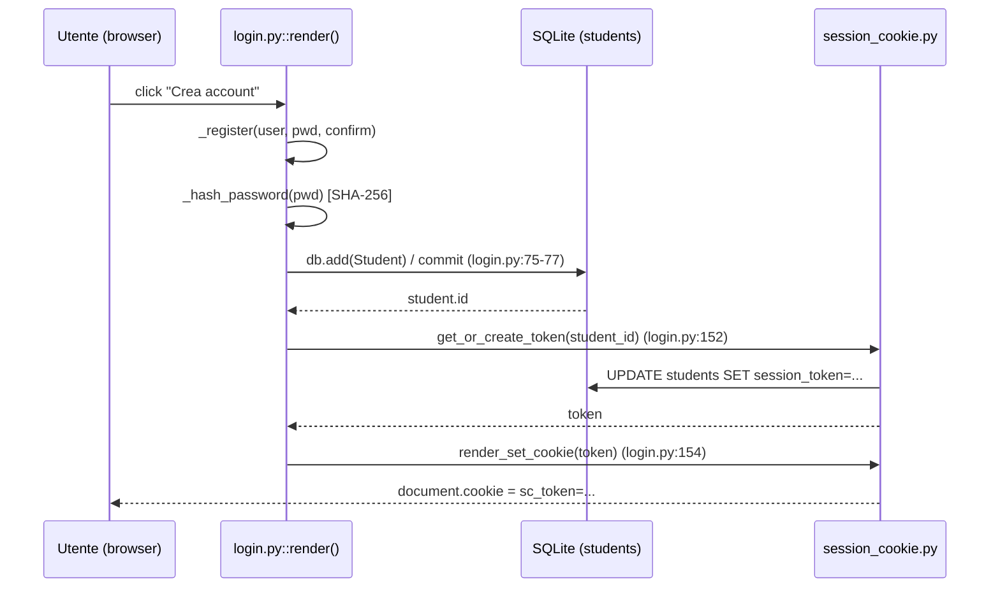
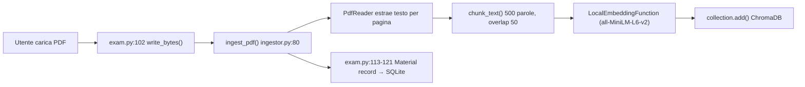
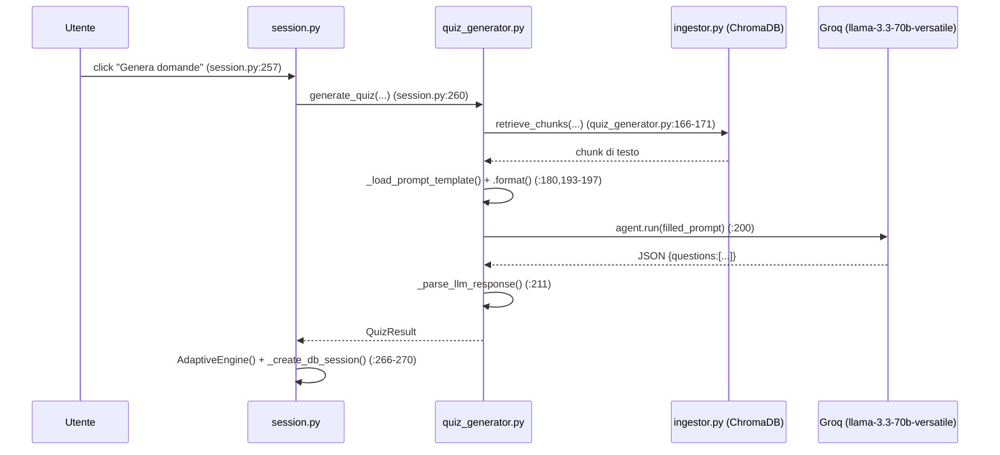
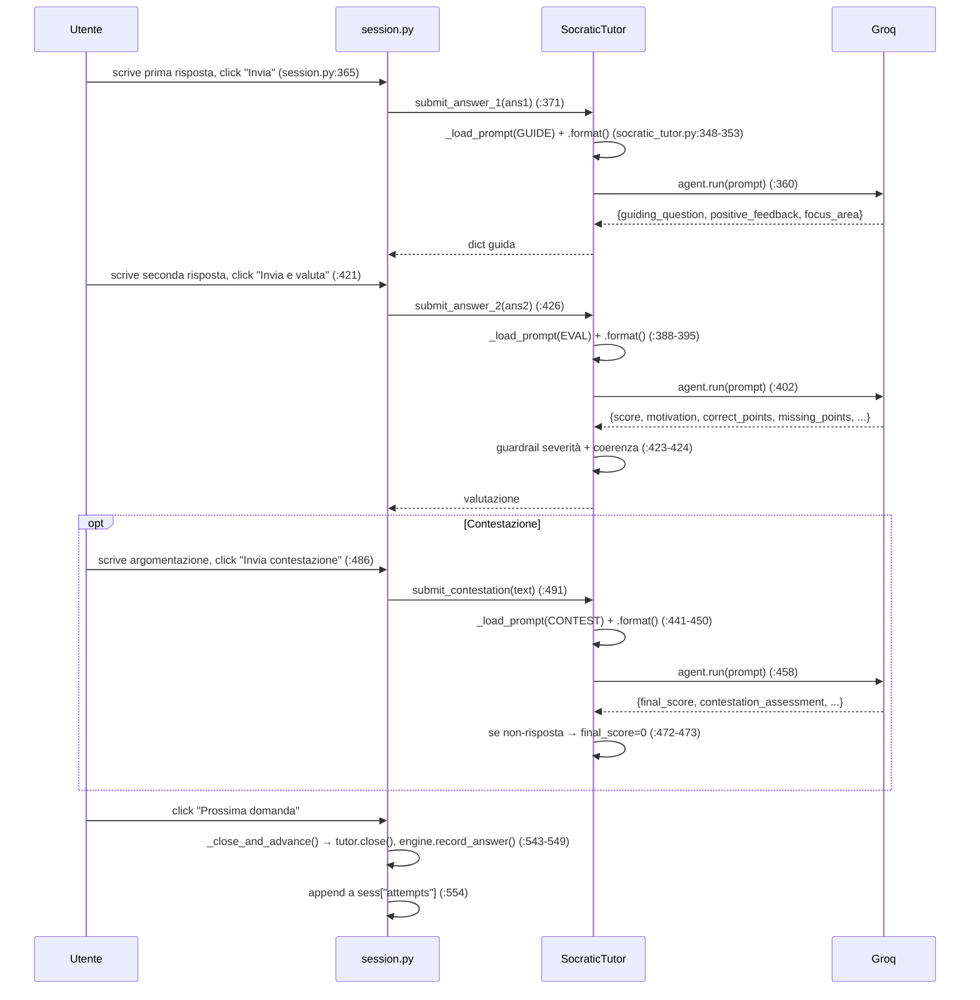
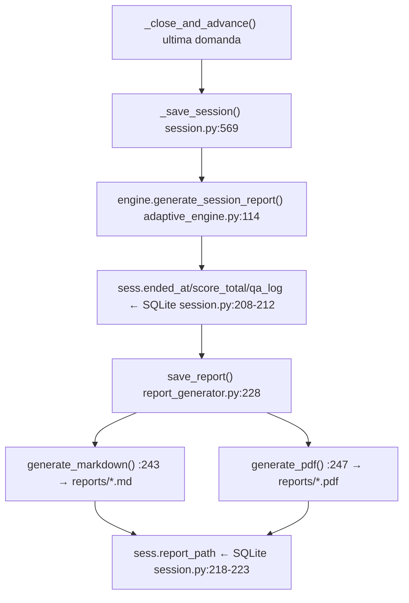
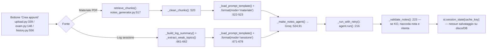
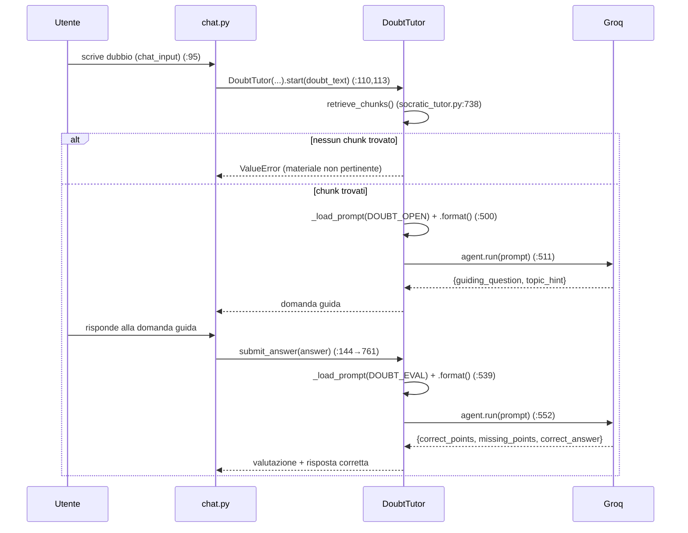

# Study Coach — Architettura e Flussi reali

> Documento generato leggendo il codice sorgente presente nel repository alla data di stesura (branch `DevOps1`). Ogni affermazione è ancorata a un riferimento `percorso/file:riga` verificato riaprendo il file. Dove il codice non permette una verifica diretta (es. comportamento interno di librerie esterne non vendorizzate nel repo) è indicato **[da verificare]**.
>
> **Nota sui segreti**: i file `.env*` sono stati letti solo per i NOMI delle variabili. Nessun valore di chiave/credenziale è riportato in questo documento.

---

## Indice

1. [Provider AI: usato o no](#1-provider-ai-usato-o-no)
2. [Persistenza: cosa viene salvato e dove](#2-persistenza-cosa-viene-salvato-e-dove)
3. [Scelte tecniche e strategie](#3-scelte-tecniche-e-strategie)
4. [Flusso per ogni fase del progetto](#4-flusso-per-ogni-fase-del-progetto)
5. [Indice file per file](#5-indice-file-per-file)

---

## 0. Come è strutturato davvero il progetto (premessa necessaria alle sezioni successive)

Il progetto ha **due punti di ingresso runtime indipendenti**, che non si chiamano a vicenda:

- **App Streamlit** ([app/main.py](../app/main.py)) — l'unica realmente usata secondo [AVVIO.md](../AVVIO.md): importa ed esegue direttamente le funzioni Python degli agenti (`backend.agents.*`), senza passare per rete.
- **API REST FastAPI** ([backend/api/main.py](../backend/api/main.py)) — espone la stessa logica di business (auth, esami, sessioni, tutor) come endpoint HTTP, con un proprio store in-memory separato (`_active_tutors`, `_active_engines` in [backend/api/sessions.py:44-45](../backend/api/sessions.py#L44-L45)). [AVVIO.md:35-37](../AVVIO.md#L35-L37) la presenta come "opzionale" ("*L'app Streamlit funziona in autonomia (chiama direttamente il backend Python), ma se serve anche l'API FastAPI...*"). Non è stata trovata nessuna chiamata `requests`/`httpx` dall'app Streamlit verso questa API (verificato via ricerca testuale su `app/`), quindi i due path **non comunicano tra loro**: la logica di orchestrazione (creazione sessione, log Q&A, generazione report) è scritta due volte, in modo leggermente diverso (vedi [Sezione 3, punto 10](#3-scelte-tecniche-e-strategie)).

Nelle Sezioni 4 e 5 il path **Streamlit è trattato come flusso primario** (è quello davvero eseguito da un utente che segue [AVVIO.md](../AVVIO.md)); l'endpoint FastAPI equivalente è citato come percorso parallelo quando esiste.

---

## 1. Provider AI: usato o no

### GROQ_API_KEY

| | |
|---|---|
| Variabile | `GROQ_API_KEY` |
| Definita in | [.env:1](../.env#L1) (solo nome, valore non riportato) |
| Letta da | Nessuna chiamata esplicita `os.getenv`/`os.environ` trovata in tutto il repo (verificato con ricerca testuale su `*.py`). `load_dotenv()` viene invocata in [backend/agents/ingestor.py:9](../backend/agents/ingestor.py#L9) *(nota: il modulo la importa ma non la usa per leggere chiavi LLM, serve ad altri moduli)*, [backend/agents/quiz_generator.py:13](../backend/agents/quiz_generator.py#L13), [backend/agents/socratic_tutor.py:21](../backend/agents/socratic_tutor.py#L21), [backend/agents/notes_generator.py:21](../backend/agents/notes_generator.py#L21). La chiave viene poi letta **implicitamente** dal SDK `agno.models.groq.Groq` quando istanziato senza parametro `api_key=` esplicito — comportamento interno della libreria `agno`, non vendorizzata nel repo e assente da `uv.lock` **[da verificare: lettura env esatta lato libreria esterna]**. |
| Entra in | `Agent(model=Groq(id=model_name))` in 6 punti: [quiz_generator.py:122](../backend/agents/quiz_generator.py#L122), [socratic_tutor.py:289](../backend/agents/socratic_tutor.py#L289) (guide), [:303](../backend/agents/socratic_tutor.py#L303) (eval), [:316](../backend/agents/socratic_tutor.py#L316) (contest), [:329](../backend/agents/socratic_tutor.py#L329) (doubt), [notes_generator.py:91](../backend/agents/notes_generator.py#L91) |
| **Verdetto** | **USATO** — 6 agenti Agno diversi lo usano come unico backend LLM del progetto |
| Modello | stringa `"llama-3.3-70b-versatile"`, costante `DEFAULT_MODEL` dichiarata **in modo indipendente e duplicato** in tre file: [quiz_generator.py:23](../backend/agents/quiz_generator.py#L23), [socratic_tutor.py:34](../backend/agents/socratic_tutor.py#L34), [notes_generator.py:29](../backend/agents/notes_generator.py#L29) |
| Task/fase | generazione quiz (fase 3), domanda guida socratica + valutazione + contestazione + dubbi liberi (fasi 4 e 7), generazione appunti (fase 6) |
| Parametri | Solo `id=model_name` passato a `Groq(...)` in tutte e 6 le istanze — **nessun** `temperature=`, `max_tokens=`/`max_output_tokens=`, `response_format=` esplicito trovato in nessuna chiamata `Agent(...)` o `Groq(...)`. Il formato JSON è imposto **solo testualmente** (istruzioni nel prompt + `description=` dell'agente, es. "Rispondi SOLO con JSON valido, senza markdown" in [socratic_tutor.py:295](../backend/agents/socratic_tutor.py#L295)), mai con un parametro strutturato. `markdown=False` è passato esplicitamente per i 5 agenti a output JSON (es. [quiz_generator.py:129](../backend/agents/quiz_generator.py#L129), [socratic_tutor.py:296](../backend/agents/socratic_tutor.py#L296)); `markdown=True` per l'unico agente a output libero, [notes_generator.py:93](../backend/agents/notes_generator.py#L93). |

### GEMINI_API_KEY

| | |
|---|---|
| Variabile | `GEMINI_API_KEY` |
| Definita in | [.env:2](../.env#L2) |
| Letta da | **Nessun punto del codice.** Nessuna chiamata `os.getenv("GEMINI...")`, nessun import di `google.generativeai`/`google-genai`/`vertexai` in tutto il repo (verificato con ricerca testuale case-insensitive su `*.py`). Non presente in [uv.lock](../uv.lock) come pacchetto. |
| **Verdetto** | **SOLO CONFIGURATO MA MAI CHIAMATO** (di fatto: nemmeno mai letta) |
| Dove compare comunque | Solo in testo (commenti/docstring/UI), mai in codice funzionante: [test/conftest.py:9](../test/conftest.py#L9) (commento), [backend/api/sessions.py:130](../backend/api/sessions.py#L130) (docstring "*Usa QuizGenerator (RAG + Gemini)*"), [backend/api/main.py:27](../backend/api/main.py#L27) (descrizione FastAPI), [backend/api/exams.py:177](../backend/api/exams.py#L177) (docstring "*tramite ChromaDB + Gemini Embeddings*"), [app/pages/login.py:163](../app/pages/login.py#L163) (footer UI "*Gemini + ChromaDB*"), [AVVIO.md:9](../AVVIO.md#L9) |
| Nota | Il vero motore di embedding è **locale** (`sentence-transformers`, vedi sotto), non Gemini. Commenti, docstring FastAPI e UI di login citano "Gemini" ma non corrispondono al codice reale: documentazione/testo disallineati dall'implementazione. |

### MISTRAL_API_KEY

| | |
|---|---|
| Variabile | `MISTRAL_API_KEY` |
| Definita in | [.env:3](../.env#L3) |
| Letta da | **Nessun punto del codice.** Nessuna chiamata `os.getenv`, nessun import di `mistralai` in tutto il repo. Non presente in [uv.lock](../uv.lock). |
| **Verdetto** | **SOLO CONFIGURATO MA MAI CHIAMATO** |
| Dove compare comunque | [test/conftest.py:9](../test/conftest.py#L9) (commento), [AVVIO.md:10](../AVVIO.md#L10) |

### Grok (xAI)

**Nessuna variabile d'ambiente per Grok/xAI esiste nel progetto** — `.env` ha solo `GROQ_API_KEY`, `GEMINI_API_KEY`, `MISTRAL_API_KEY` ([.env:1-3](../.env#L1-L3)). Nessun riferimento a "grok" o "xai" (case-insensitive) è stato trovato in nessun file `.py` del repo.

> ⚠️ **Nota per l'utente**: il provider realmente usato per tutte le chiamate LLM del progetto è **Groq** (Groq Inc., acceleratore di inferenza LPU — variabile `GROQ_API_KEY`, libreria `agno.models.groq`), non **Grok** (il modello di xAI). Sono due prodotti distinti e non correlati, facilmente confondibili per il nome quasi identico. Se l'intenzione era integrare Grok/xAI, questo non risulta implementato in nessuna parte del codice.

### Altri provider/modelli trovati

| Provider/modello | Uso | Dove |
|---|---|---|
| `sentence-transformers` — modello `all-MiniLM-L6-v2` | Embedding **locale** per la ricerca semantica RAG, nessuna chiave API, nessuna chiamata di rete | [backend/agents/ingestor.py:25](../backend/agents/ingestor.py#L25), classe `LocalEmbeddingFunction` [:33-52](../backend/agents/ingestor.py#L33-L52) |

Nessun modello di moderazione immagini o altro provider AI è stato trovato nel repo.

### Tabella riassuntiva

| Provider | Variabile | Modello | Task | Verdetto | File:riga (chiamata) |
|---|---|---|---|---|---|
| Groq | `GROQ_API_KEY` | `llama-3.3-70b-versatile` | Generazione quiz | USATO | [quiz_generator.py:199-200](../backend/agents/quiz_generator.py#L199-L200) |
| Groq | `GROQ_API_KEY` | `llama-3.3-70b-versatile` | Domanda guida socratica | USATO | [socratic_tutor.py:354,360](../backend/agents/socratic_tutor.py#L354) |
| Groq | `GROQ_API_KEY` | `llama-3.3-70b-versatile` | Valutazione risposta | USATO | [socratic_tutor.py:396,402](../backend/agents/socratic_tutor.py#L396) |
| Groq | `GROQ_API_KEY` | `llama-3.3-70b-versatile` | Contestazione voto | USATO | [socratic_tutor.py:452,458](../backend/agents/socratic_tutor.py#L452) |
| Groq | `GROQ_API_KEY` | `llama-3.3-70b-versatile` | Dubbio libero (apertura+valutazione) | USATO | [socratic_tutor.py:505,511,546,552](../backend/agents/socratic_tutor.py#L505) |
| Groq | `GROQ_API_KEY` | `llama-3.3-70b-versatile` | Generazione appunti | USATO | [notes_generator.py:524-525](../backend/agents/notes_generator.py#L524-L525) |
| sentence-transformers | *(nessuna, locale)* | `all-MiniLM-L6-v2` | Embedding RAG | USATO | [ingestor.py:25](../backend/agents/ingestor.py#L25) |
| Gemini | `GEMINI_API_KEY` | — | — | SOLO CONFIGURATO, MAI CHIAMATO | n/d |
| Mistral | `MISTRAL_API_KEY` | — | — | SOLO CONFIGURATO, MAI CHIAMATO | n/d |
| Grok/xAI | *(assente)* | — | — | NON PRESENTE NEL PROGETTO | n/d |

---

## 2. Persistenza: cosa viene salvato e dove

### 2.1 Tabelle SQLite (SQLAlchemy, `sqlite:///data/study_coach.db`, motore in [backend/db/models.py:55](../backend/db/models.py#L55))

Nessuno strumento di migrazione dedicato (no Alembic): `init_db()` ([:57-59](../backend/db/models.py#L57-L59)) chiama `Base.metadata.create_all(engine)` e poi `_ensure_session_token_column()` ([:62-71](../backend/db/models.py#L62-L71)), l'unica "migrazione" del progetto — un `ALTER TABLE` scritto a mano per aggiungere `session_token` se assente.

#### `students` — [backend/db/models.py:14-21](../backend/db/models.py#L14-L21)
Colonne: `id` PK, `username` (unique, not null), `password_hash`, `session_token` (unique, nullable — aggiunta via migrazione manuale), `created_at`. Nessun indice esplicito oltre a PK/unique.
- **Scrive**: [backend/api/auth.py:54-59](../backend/api/auth.py#L54-L59) (register), [app/pages/login.py:71-77](../app/pages/login.py#L71-L77) (`_register`); [backend/session_cookie.py:28-29](../backend/session_cookie.py#L28-L29) (`get_or_create_token` scrive `session_token`), [:55](../backend/session_cookie.py#L55) (`invalidate_token` lo azzera).
- **Legge**: [backend/api/auth.py:23](../backend/api/auth.py#L23) (`_get_student_by_username`); [app/pages/login.py:36](../app/pages/login.py#L36) (`_login`); [backend/session_cookie.py:42](../backend/session_cookie.py#L42) (`verify_token`, chiamata anche da [app/main.py:160](../app/main.py#L160) per l'auto-login da cookie); anche [:24](../backend/session_cookie.py#L24), dentro `get_or_create_token` (funzione diversa da `verify_token`, corretto rispetto a una versione precedente di questo documento), legge lo `Student` per id prima di generare/restituire il token.

#### `exams` — [backend/db/models.py:23-31](../backend/db/models.py#L23-L31)
Colonne: `id` PK, `student_id` FK→`students.id`, `name`, `created_at`. `cascade="all, delete"` su `sessions` e `materials`.
- **Scrive**: [backend/api/exams.py:102-105](../backend/api/exams.py#L102-L105) (`create_exam`); [app/pages/upload.py:42-46](../app/pages/upload.py#L42-L46) (`_create_exam`), [:57-59](../app/pages/upload.py#L57-L59) (`_rename_exam`), [:75](../app/pages/upload.py#L75) (`_delete_exam`, cascade su sessioni/materiali).
- **Legge**: [backend/api/exams.py:77-82](../backend/api/exams.py#L77-L82) (`list_exams`); [app/pages/upload.py:34](../app/pages/upload.py#L34) (`_get_exams`); [app/pages/history.py:122](../app/pages/history.py#L122) (`_get_all_exams`).

#### `materials` — [backend/db/models.py:33-42](../backend/db/models.py#L33-L42)
Colonne: `id` PK, `exam_id` FK, `filename`, `stored_path`, `chunks_count`, `pages_count`, `uploaded_at`.
- **Scrive**: [app/pages/upload.py:106-116](../app/pages/upload.py#L106-L116) (`_create_material_record`); [app/pages/exam.py:113-121](../app/pages/exam.py#L113-L121) (handler upload inline).
- **Legge**: [app/pages/upload.py:97](../app/pages/upload.py#L97) (`_get_exam_materials`); [app/pages/exam.py:55](../app/pages/exam.py#L55) (query materiali).

#### `sessions` — [backend/db/models.py:44-53](../backend/db/models.py#L44-L53)
Colonne: `id` PK, `exam_id` FK, `started_at`, `ended_at` (nullable), `score_total` (Float, nullable), `qa_log` (**Text**, JSON serializzato come stringa — non un tipo JSON/vettoriale nativo), `report_path`.
- **Scrive**: [backend/api/sessions.py:94-97](../backend/api/sessions.py#L94-L97) (`create_session`), [:371-373](../backend/api/sessions.py#L371-L373) (`_append_attempt_to_log` scrive `qa_log`), [:441-443](../backend/api/sessions.py#L441-L443) (`close_session` aggiorna `ended_at`/`score_total`/`report_path`); [app/pages/session.py:176-179](../app/pages/session.py#L176-L179) (`_create_db_session`), [:208-221](../app/pages/session.py#L208-L221) (`_save_session`); [app/pages/upload.py:178](../app/pages/upload.py#L178) e [app/pages/exam.py:25](../app/pages/exam.py#L25) (chiusura sessioni orfane, `ended_at=now`); [app/pages/history.py:98-99](../app/pages/history.py#L98-L99) (`_regenerate_pdf_report`), [:183](../app/pages/history.py#L183) (`_close_session`), [:163-164](../app/pages/history.py#L163-L164) (`_delete_session`).
- **Legge**: [backend/api/sessions.py:478-480](../backend/api/sessions.py#L478-L480) (`get_session`), [:504-509](../backend/api/sessions.py#L504-L509) (`list_sessions`); [app/pages/history.py:127-149](../app/pages/history.py#L127-L149) (`_get_sessions`).

### 2.2 Salvataggi fuori dal DB relazionale

#### ChromaDB (vettoriale) — `data/chroma/`
Path costante [ingestor.py:11](../backend/agents/ingestor.py#L11), client persistente [:12](../backend/agents/ingestor.py#L12). Una collection per coppia (studente, esame), nome `f"student_{student_id}_exam_{exam_id}"` ([:60](../backend/agents/ingestor.py#L60)), creata/recuperata da `get_collection()` ([:58-65](../backend/agents/ingestor.py#L58-L65)). Contiene per ogni chunk: `documents` (testo), `metadatas` (`student_id`, `exam_id`, `page`, `source`, `source_file` — [:105-111](../backend/agents/ingestor.py#L105-L111)), `ids` nel formato `s{student_id}_e{exam_id}_c{counter}` ([:112](../backend/agents/ingestor.py#L112)). Gli embedding sono calcolati da `LocalEmbeddingFunction` ([:33-52](../backend/agents/ingestor.py#L33-L52)) e gestiti internamente da ChromaDB (non ispezionabili direttamente dal codice applicativo).
- **Scrive**: `collection.add(...)` in `ingest_pdf()` [:117-122](../backend/agents/ingestor.py#L117-L122), chiamato da [backend/api/exams.py:208](../backend/api/exams.py#L208) e [app/pages/exam.py:109](../app/pages/exam.py#L109).
- **Legge**: `collection.query(...)` in `retrieve_chunks()` [:136](../backend/agents/ingestor.py#L136); `collection.get(...)` in `retrieve_chunks_by_source()` [:146-150](../backend/agents/ingestor.py#L146-L150) — entrambe chiamate da tutti e 3 gli agenti generativi per costruire il contesto RAG (es. [quiz_generator.py:166-171](../backend/agents/quiz_generator.py#L166-L171)).
- **Elimina**: `client.delete_collection(...)` [:161](../backend/agents/ingestor.py#L161), chiamato da [backend/api/exams.py:162](../backend/api/exams.py#L162) e [app/pages/upload.py:86](../app/pages/upload.py#L86).

#### File PDF caricati — `data/uploads/`
Nome file `s{student_id}_e{exam_id}_{filename}`. Scritti da [backend/api/exams.py:192,198-199](../backend/api/exams.py#L192-L199) e [app/pages/exam.py:101-102](../app/pages/exam.py#L101-L102).

#### Report di sessione (Markdown + PDF) — `reports/`
Generati da `save_report()` [report_generator.py:228-249](../backend/agents/report_generator.py#L228-L249). Path: `f"{student_id}_{exam_id}_{session_id}.md"` / `.pdf` ([:238-241](../backend/agents/report_generator.py#L238-L241)), scritti con `.write_text()`/`.write_bytes()` ([:244,248](../backend/agents/report_generator.py#L244)).

#### Sessione browser — `st.session_state` (Streamlit, in-memory, non persistente)
Chiavi principali dichiarate in [app/main.py:132-147](../app/main.py#L132-L147).

#### Login persistente — cookie browser `sc_token`
Nome cookie [backend/session_cookie.py:12](../backend/session_cookie.py#L12); scrittura via JS in `render_set_cookie()` [:65-75](../backend/session_cookie.py#L65-L75); lettura via probe JS + query param `token` in [app/main.py:157-171](../app/main.py#L157-L171) e [session_cookie.py:91-109](../backend/session_cookie.py#L91-L109). Il valore è lo stesso `students.session_token`.

#### Stato in-memory lato FastAPI (perso al riavvio del processo, path parallelo non usato dalla UI)
`_active_tutors`, `_active_engines`: dict a livello di modulo, [backend/api/sessions.py:44-45](../backend/api/sessions.py#L44-L45).

#### Log applicativi
Nessun file di log: solo `print()` su stdout (es. [ingestor.py:130](../backend/agents/ingestor.py#L130), [adaptive_engine.py:77-81](../backend/agents/adaptive_engine.py#L77-L81)) e `logging.getLogger(__name__)` senza handler esplicito configurato nel repo in [app/pages/upload.py:18](../app/pages/upload.py#L18) e [app/pages/history.py:21](../app/pages/history.py#L21) **[da verificare: eventuale configurazione handler a runtime da Streamlit/uvicorn]**.

### 2.3 Salvataggi dei risultati AI

- **Domande del quiz**: non hanno una tabella dedicata. Vivono come oggetto `QuizResult`/`Question` ([quiz_generator.py:31-46](../backend/agents/quiz_generator.py#L31-L46)) in `st.session_state.current_session["questions"]` ([app/pages/session.py:272-290](../app/pages/session.py#L272-L290)) per la durata della sessione browser, oppure nella risposta HTTP `QuizGenerateResponse` per il path FastAPI ([backend/api/sessions.py:154-169](../backend/api/sessions.py#L154-L169)). Sopravvivono solo indirettamente tramite `qa_log` (sotto).
- **Risposte studente + domanda guida + valutazione + contestazione**: serializzate come dict piatto da `_attempt_to_log_entry()` ([app/pages/session.py:39-77](../app/pages/session.py#L39-L77)) o da `SocraticTutor.to_dict()` ([socratic_tutor.py:689-694](../backend/agents/socratic_tutor.py#L689-L694)), accumulate nella colonna `sessions.qa_log` — non esistono colonne separate per punteggio-per-domanda, tutto vive in questo blob JSON testuale.
- **Punteggio aggregato**: `sessions.score_total`, scritto una sola volta alla chiusura sessione.
- **Embedding**: solo in ChromaDB, mai nel DB relazionale.
- **Appunti generati** (`notes_generator`): **non persistiti su disco né in DB**. Restituiti come stringa Markdown o bytes PDF, tenuti solo in `st.session_state[cache_key]` ([app/pages/upload.py:359](../app/pages/upload.py#L359), [app/pages/history.py:574](../app/pages/history.py#L574), [app/pages/exam.py:157-163](../app/pages/exam.py#L157-L163)) per la sessione del browser corrente; l'utente li scarica via `st.download_button`, il server non ne mantiene copia permanente.

---

## 3. Scelte tecniche e strategie

1. **Retrieval senza soglia di similarità**: `collection.query(...)` ([ingestor.py:134-140](../backend/agents/ingestor.py#L134-L140)) restituisce sempre i primi `n_results` risultati (5/8/10/12/15 a seconda del chiamante), senza filtrare per uno score minimo di similarità. — *[motivazione da chiarire con il team]*

2. **Embedding locali invece di un servizio remoto**: `sentence-transformers` `all-MiniLM-L6-v2` ([ingestor.py:14-52](../backend/agents/ingestor.py#L14-L52)) invece di un embedding API-based (nonostante "Gemini Embeddings" sia nominato in docstring/UI, vedi Sezione 1). Motivazione dichiarata in [AGENTS.md](../AGENTS.md) ("garantire privacy e funzionamento offline senza costi API"), non nel codice stesso. Alternativa scartata: Gemini Embeddings (mai implementata).

3. **Chunking a finestra fissa con overlap**: `chunk_text()` ([ingestor.py:68-77](../backend/agents/ingestor.py#L68-L77)), `chunk_size=500` parole, `overlap=50` parole, split per spazi (non per token né per frase/paragrafo). Nessuna alternativa documentata nel codice.

4. **Retry infinito, nessun fallback tra provider/modelli**: tutte e 3 le pipeline generative usano `while True` senza limite massimo di tentativi — [quiz_generator.py:187-252](../backend/agents/quiz_generator.py#L187-L252), le funzioni `_generate_*`/`_evaluate*` in [socratic_tutor.py](../backend/agents/socratic_tutor.py) (es. [:356-380](../backend/agents/socratic_tutor.py#L356-L380)), `_run_with_retry()` in [notes_generator.py:206-232](../backend/agents/notes_generator.py#L206-L232). Commenti nel codice dichiarano esplicitamente la scelta (es. [quiz_generator.py:161-163](../backend/agents/quiz_generator.py#L161-L163): "*Nessun fallback: in caso di errore o risposta non valida si ritenta indefinitamente*"). Alternativa scartata (dichiarata nei commenti): nessun fallback a un modello/provider diverso, nessun cap sui tentativi.

5. **Backoff euristico basato su parsing testuale del messaggio d'errore**: `_is_rate_limit_error()` + `_parse_retry_after()` ([socratic_tutor.py:55-85](../backend/agents/socratic_tutor.py#L55-L85), pattern analogo in [quiz_generator.py:133-143](../backend/agents/quiz_generator.py#L133-L143) e [notes_generator.py:58-85](../backend/agents/notes_generator.py#L58-L85)) — regex tipo `\d+h\d+m\d+\.?\d*s` sul testo di errore restituito dall'agente, con cap a 60s (es. `min(wait, 60)` in [socratic_tutor.py:367](../backend/agents/socratic_tutor.py#L367)). Non è un backoff esponenziale standard: dipende dal formato testuale esatto del messaggio d'errore del provider.

6. **Parsing JSON non uniforme tra i moduli**: `quiz_generator.py::_parse_llm_response()` ([:64-115](../backend/agents/quiz_generator.py#L64-L115)) ripara backtick, trailing comma, virgolette singole ed estrae tra prima/ultima graffa; `socratic_tutor.py::_parse_json()` ([:181-189](../backend/agents/socratic_tutor.py#L181-L189)) fa solo strip dei backtick e solleva `ValueError` se il JSON non è valido — nessuna riparazione. Il parser più usato (5 chiamate per domanda) è il meno robusto. — *[motivazione da chiarire con il team]*

7. **Guardrail deterministici in Python sopra l'output del modello**: oltre alle regole scritte nel prompt ([socratic_tutor_eval_v1.txt:44-52](../backend/agents/prompts/socratic_tutor_eval_v1.txt#L44-L52) — "Regole di severità obbligatorie" e "Regole di coerenza", che dal 2026-09-21 includono anche una nota per sviluppatori esplicita su questa stessa ridondanza, [:4-9](../backend/agents/prompts/socratic_tutor_eval_v1.txt#L4-L9)), il codice le riapplica forzatamente dopo la risposta LLM: `_apply_severity_guardrails()` ([socratic_tutor.py:199-221](../backend/agents/socratic_tutor.py#L199-L221), forza `score=0` se la risposta è una non-risposta secondo `_is_non_answer()`/`NON_ANSWER_PATTERNS` [:38-48](../backend/agents/socratic_tutor.py#L38-L48)) e `_apply_consistency_guardrails()` ([:253-279](../backend/agents/socratic_tutor.py#L253-L279), forza `score=9` se `missing_points` non descrive lacune reali, pattern `NO_GAPS_PATTERNS` [:227-233](../backend/agents/socratic_tutor.py#L227-L233)). La stessa logica di non-risposta è riapplicata anche in `_re_evaluate_after_contestation()` ([:471-473](../backend/agents/socratic_tutor.py#L471-L473): `if _is_non_answer(...): final_score = 0`), sebbene il prompt di contestazione non la menzioni esplicitamente nel proprio testo — il codice ha sempre l'ultima parola sul punteggio, il modello propone soltanto.

8. **Adattività a priorità discreta, non a ranking numerico**: `pick_next_question()` ([adaptive_engine.py:83-112](../backend/agents/adaptive_engine.py#L83-L112)) sceglie sempre la prima domanda che soddisfa la priorità più alta disponibile (1: topic debole già visto [:91-98](../backend/agents/adaptive_engine.py#L91-L98); 2: topic mai visto [:101-109](../backend/agents/adaptive_engine.py#L101-L109); 3: qualunque rimanente [:112](../backend/agents/adaptive_engine.py#L112)), non un punteggio pesato continuo. "Debole" (`TopicStats.is_weak`, [:26-32](../backend/agents/adaptive_engine.py#L26-L32)): media `< 6.0`, oppure singolo tentativo con score `< 5` (soglia più severa per un solo tentativo isolato).

9. **Separazione in agenti Agno per responsabilità** (multi-agente): 4 agenti distinti con `description=` diversi nel loop socratico ([socratic_tutor.py:286-336](../backend/agents/socratic_tutor.py#L286-L336)) invece di un agente unico con prompt condizionale. Motivazione dichiarata in [AGENTS.md](../AGENTS.md) ("riduce drasticamente le allucinazioni") — non verificabile empiricamente dal solo codice. — *[da verificare]*

10. **Due path di orchestrazione paralleli e duplicati** (vedi anche [Sezione 0](#0-come-è-strutturato-davvero-il-progetto-premessa-necessaria-alle-sezioni-successive)): la UI Streamlit importa direttamente `backend.agents.*`; `backend/api/*.py` espone la stessa logica via REST con un proprio store in-memory. Nessuna chiamata HTTP dalla UI verso l'API è stata trovata. Risultato: la stessa logica applicativa (creazione sessione, log Q&A, generazione report) è implementata due volte in modo leggermente diverso — es. `_save_session()` in [app/pages/session.py:185-233](../app/pages/session.py#L185-L233) vs `close_session()`+`_append_attempt_to_log()` in [backend/api/sessions.py:420-379](../backend/api/sessions.py#L364-L379) — senza che l'una chiami l'altra.

11. **Validazione dell'output non-JSON con retry "guidato dall'errore"** (solo `notes_generator`): `_validate_notes()` ([notes_generator.py:189-203](../backend/agents/notes_generator.py#L189-L203)) controlla lunghezza minima (700 parole), presenza di pattern regex (`## .*`, `> \*\*Definizione`, `## Riepilogo`), assenza di LaTeX corrotto residuo. Se fallisce, il messaggio di errore viene **accodato al prompt** e reinviato ([:227](../backend/agents/notes_generator.py#L227): `prompt += f"\n\nNOTA: {msg}..."`) — diverso dal retry "cieco" (stesso prompt, nuovo tentativo) usato dagli altri due generatori.

12. **Tre strategie diverse per "sessione incompleta"**, a seconda del punto d'ingresso:
    - **Cancellazione hard** se la sessione ha `started_at` ma `score_total` NULL, prima di mostrare le liste: [backend/api/sessions.py:497-501](../backend/api/sessions.py#L497-L501) (`list_sessions`) e [app/pages/history.py:131-142](../app/pages/history.py#L131-L142) (`_get_sessions`) — entrambe usano `.delete(...)`.
    - **Chiusura soft** (`ended_at=now`, `qa_log` parziale preservato) quando l'utente esce esplicitamente e ha già risposto ad almeno una domanda: `_mark_session_interrupted()` ([app/pages/session.py:109-134](../app/pages/session.py#L109-L134)).
    - **Chiusura per sessioni orfane multiple** all'avvio di una nuova sessione sullo stesso esame: `_close_orphan_sessions()` in [app/pages/upload.py:162-186](../app/pages/upload.py#L162-L186) e [app/pages/exam.py:16-32](../app/pages/exam.py#L16-L32) (duplicata identica in due file).

13. **Autenticazione minimale**: password con `hashlib.sha256` puro, **nessun salt**, nessun bcrypt/argon2 — [backend/api/auth.py:16-17](../backend/api/auth.py#L16-L17), [app/pages/login.py:21-22](../app/pages/login.py#L21-L22) — nonostante `bcrypt` sia presente in [uv.lock:49](../uv.lock#L49) come dipendenza **transitiva di `chromadb`** ([uv.lock:198-199](../uv.lock#L198-L199)), mai importato direttamente nel codice applicativo (verificato: nessun `import bcrypt`). Sessione persistente via token opaco (`secrets.token_urlsafe(32)`, [session_cookie.py:28](../backend/session_cookie.py#L28)) invece di JWT — dichiarato esplicitamente: "*questa API non emette JWT [...] Per un deploy con frontend separato aggiungere un middleware JWT*" ([auth.py:85-87](../backend/api/auth.py#L85-L87)).

14. **Dipendenze applicative non dichiarate nel gestore pacchetti**: [pyproject.toml:5](../pyproject.toml#L5) dichiara `dependencies = []` (vuoto) e [uv.lock:1367-1374](../uv.lock#L1367-L1374) elenca solo 6 pacchetti diretti per `studycoach` (`chromadb`, `protobuf`, `pypdf`, `pytest`, `python-dotenv`, `sqlalchemy`). **`agno`, `fastapi`, `streamlit`, `fpdf`/`fpdf2`, `sentence-transformers` sono importati nel codice ma assenti sia da `pyproject.toml` sia da `uv.lock`** (verificato: nessun pacchetto con questi nomi in tutto `uv.lock`). [AVVIO.md:24](../AVVIO.md#L24) menziona un `requirements.txt` "se presente" che **non esiste nel repo** (verificato via ricerca file). L'ambiente che effettivamente esegue il progetto deve quindi avere questi pacchetti installati per una via non tracciata dai file di gestione dipendenze del repository. — *[motivazione da chiarire con il team]*

15. **Template dei prompt standardizzato su una struttura comune** (aggiornamento del 2026-09-21): i 7 file in [backend/agents/prompts/](../backend/agents/prompts/) seguono ora tutti le sezioni `## Input` (solo documentale), `## Regole di comportamento`, `## Vincoli sull'output`, `## Da evitare`, separate — per 6 dei 7 file — dal paragrafo di ruolo iniziale tramite lo stesso delimitatore `---\n\n` già presente prima (vedi meccanismo descritto al punto 4.3/4.4/4.6/4.7 sotto: `_load_prompt`/`_load_prompt_template` scartano tutto ciò che precede il primo `---\n\n`). `quiz_generator_v1.txt` resta l'eccezione strutturale: non ha separatore, quindi anche il suo paragrafo di ruolo iniziale fa parte del testo effettivamente inviato a Groq — comportamento preesistente, non introdotto da questo aggiornamento. Segnaposto `.format()`, schema JSON di output e logica Python non sono stati modificati da questa riscrittura.

---

## 4. Flusso per ogni fase del progetto

> Le fasi elencate sono state ricavate dal codice raggruppando gli agenti/router per responsabilità. Rispetto ad [AGENTS.md](../AGENTS.md) (che elenca 5 fasi macro), qui **Adattamento** e **Loop socratico** sono tenute separate (agente Agno vs euristica Python pura in `adaptive_engine.py`, moduli e responsabilità diversi), e la **Chat dubbi liberi** (`DoubtTutor`) è trattata come fase a sé perché ha un proprio entry point UI ([app/pages/chat.py](../app/pages/chat.py)) indipendente dal loop quiz. Lo **Storico sessioni** ([app/pages/history.py](../app/pages/history.py)) non ha una propria pipeline generativa: riusa `report_generator`/`notes_generator` già descritti nelle fasi 5 e 6, quindi non compare come fase a parte.

### 4.1 Autenticazione

**Punto di ingresso**: `render()` in [app/pages/login.py:92](../app/pages/login.py#L92), invocato da [app/main.py:179-180](../app/main.py#L179-L180) quando `current_page == "login"`. Equivalente FastAPI (parallelo, non usato dalla UI): `POST /auth/register` e `POST /auth/login` in [backend/api/auth.py:38](../backend/api/auth.py#L38) e [:81](../backend/api/auth.py#L81).

**Catena di chiamate** (registrazione):
1. Click bottone "Crea account" → `_register(new_user, new_pwd, new_pwd2)` [login.py:150](../app/pages/login.py#L150)
2. `_register()` → `_hash_password(password)` [login.py:73](../app/pages/login.py#L73) (SHA-256, [:21-22](../app/pages/login.py#L21-L22))
3. `_register()` → `db.add(student)` / `db.commit()` [login.py:75-77](../app/pages/login.py#L75-L77) — scrive tabella `students`
4. Al successo → `get_or_create_token(student_id)` [login.py:152](../app/pages/login.py#L152) → `render_set_cookie(token)` [:154](../app/pages/login.py#L154) — scrive cookie `sc_token`

**Input/Output**: input `username`, `password`, `confirm` (form Streamlit); output `st.session_state.authenticated=True` + redirect a pagina `upload`.

**Prompt/LLM coinvolti**: nessuno — fase puramente CRUD, nessuna chiamata a nessun agente.

**Persistenza**: tabella `students` (vedi [Sezione 2.1](#21-tabelle-sqlite-sqlalchemy-sqlitedatastudy_coachdb-motore-in-backenddbmodelspyl55)); cookie browser `sc_token` (vedi [Sezione 2.2](#22-salvataggi-fuori-dal-db-relazionale)).

---

### 4.2 Ingestion materiale (indicizzazione RAG)

**Punto di ingresso**: file uploader in `render()` di [app/pages/exam.py:86-92](../app/pages/exam.py#L86-L92) (dentro la pagina esame). Equivalente FastAPI: `POST /exams/{exam_id}/ingest` in [backend/api/exams.py:170](../backend/api/exams.py#L170).

**Catena di chiamate**:
1. Upload PDF → `pdf_path.write_bytes(file_obj.read())` [exam.py:102](../app/pages/exam.py#L102) — salva su `data/uploads/`
2. → `ingest_pdf(str(pdf_path), student_id, exam['id'])` [exam.py:109](../app/pages/exam.py#L109)
3. `ingest_pdf()` [ingestor.py:80](../backend/agents/ingestor.py#L80) → `PdfReader(...)` [:85](../backend/agents/ingestor.py#L85), estrae testo pagina per pagina [:87-90](../backend/agents/ingestor.py#L87-L90)
4. → `chunk_text(text)` per pagina [:101](../backend/agents/ingestor.py#L101) (finestra 500 parole, overlap 50)
5. → `get_collection(student_id, exam_id)` [:115](../backend/agents/ingestor.py#L115) → `collection.add(...)` [:118-122](../backend/agents/ingestor.py#L118-L122) (embedding calcolato internamente da `LocalEmbeddingFunction`)
6. Ritorno a `exam.py` → `db.add(Material(...))` / `commit()` [exam.py:113-121](../app/pages/exam.py#L113-L121) — scrive tabella `materials`

**Input/Output**: input file PDF binario; output `dict` statistiche (`file`, `pages`, `chunks`, `collection`, [ingestor.py:124-129](../backend/agents/ingestor.py#L124-L129)).

**Prompt/LLM coinvolti**: nessuno — nessuna chiamata LLM in questa fase, solo embedding locale.

**Persistenza**: file PDF su `data/uploads/`; chunk+embedding in ChromaDB; riga in `materials`.

---

### 4.3 Generazione quiz

**Punto di ingresso**: bottone "🚀 Genera domande" in `_render_quiz_generation()` [app/pages/session.py:238](../app/pages/session.py#L238). Equivalente FastAPI: `POST /sessions/{session_id}/quiz` [backend/api/sessions.py:124](../backend/api/sessions.py#L124).

**Catena di chiamate**:
1. Click bottone → `generate_quiz(student_id, exam_id, n_questions, source_name)` [session.py:260](../app/pages/session.py#L260)
2. `generate_quiz()` [quiz_generator.py:150](../backend/agents/quiz_generator.py#L150) → `retrieve_chunks(query, student_id, exam_id, n_results)` [:166-171](../backend/agents/quiz_generator.py#L166-L171) (RAG su ChromaDB, `topic_query` di default "concetti principali del corso")
3. → `_load_prompt_template()` [:180](../backend/agents/quiz_generator.py#L180) — carica [prompts/quiz_generator_v1.txt](../backend/agents/prompts/quiz_generator_v1.txt)
4. → `template.format(n_questions=..., source_name=..., context_chunks=...)` [:193-197](../backend/agents/quiz_generator.py#L193-L197)
5. → `_make_quiz_agent(model_name)` [:199](../backend/agents/quiz_generator.py#L199) — istanzia `Agent(model=Groq(id="llama-3.3-70b-versatile"))` [:122](../backend/agents/quiz_generator.py#L122)
6. → `agent.run(filled_prompt, stream=False)` [:200](../backend/agents/quiz_generator.py#L200) — **qui il prompt viene inviato a Groq**
7. → `_parse_llm_response(raw_text)` [:211](../backend/agents/quiz_generator.py#L211) — valida/ripara JSON, costruisce lista `Question`
8. Ritorno a `session.py` → crea `AdaptiveEngine` [:266-269](../app/pages/session.py#L266-L269), `_create_db_session()` [:270](../app/pages/session.py#L270) (scrive tabella `sessions`), popola `st.session_state.current_session` [:282-290](../app/pages/session.py#L282-L290)

**Input/Output**: input `student_id`, `exam_id`, `n_questions` (slider 3-10), `source_name`; output `QuizResult` (lista `Question{id, text, difficulty, topic_hint}`).

**Prompt/LLM**: [backend/agents/prompts/quiz_generator_v1.txt](../backend/agents/prompts/quiz_generator_v1.txt), caricato a [quiz_generator.py:180](../backend/agents/quiz_generator.py#L180), inviato a Groq (`llama-3.3-70b-versatile`) a [:200](../backend/agents/quiz_generator.py#L200).

**Persistenza**: nuova riga `sessions` (solo `id`, `exam_id`, `started_at`); domande tenute in `st.session_state`, non persistite direttamente (vedi [Sezione 2.3](#23-salvataggi-dei-risultati-ai)).

---

### 4.4 Loop socratico (per singola domanda)

Questa è la fase centrale descritta in [AGENTS.md](../AGENTS.md) come "metodo socratico". Copre: prima risposta → domanda guida → seconda risposta → valutazione → contestazione opzionale → chiusura.

**Punto di ingresso**: `_render_active_session()` [app/pages/session.py:306](../app/pages/session.py#L306), chiamata da `render()` [:701-714](../app/pages/session.py#L701-L714) quando esiste una sessione attiva con domande rimanenti. Equivalente FastAPI: `POST /sessions/{id}/tutor/start|answer1|answer2|contest|close` [backend/api/sessions.py:181,215,249,286,323](../backend/api/sessions.py#L181).

**Catena di chiamate — inizio domanda**:
1. `state == "idle"` → `engine.pick_next_question(sess["remaining"])` [session.py:323](../app/pages/session.py#L323) (euristica adattiva, [Sezione 3, punto 8](#3-scelte-tecniche-e-strategie))
2. → `SocraticTutor(student_id, exam_id)` [session.py:328](../app/pages/session.py#L328) → `new_tutor.start(next_q)` [:332](../app/pages/session.py#L332)
3. `SocraticTutor.start()` [socratic_tutor.py:602](../backend/agents/socratic_tutor.py#L602) → `retrieve_chunks(question_text, ...)` [:610-615](../backend/agents/socratic_tutor.py#L610-L615) — pre-fetch RAG, cache in `self._context_cache`

**Catena di chiamate — prima risposta → domanda guida**:
4. `tutor.submit_answer_1(ans1)` [session.py:371](../app/pages/session.py#L371) → `SocraticTutor.submit_answer_1()` [socratic_tutor.py:618](../backend/agents/socratic_tutor.py#L618) → `_generate_guiding_question(attempt, context_cache, model_name)` [:623](../backend/agents/socratic_tutor.py#L623)
5. `_generate_guiding_question()` [:343](../backend/agents/socratic_tutor.py#L343) → `_load_prompt(PROMPT_GUIDE)` [:348](../backend/agents/socratic_tutor.py#L348) — carica [prompts/socratic_tutor_guide_v1.txt](../backend/agents/prompts/socratic_tutor_guide_v1.txt)
6. → `template.format(question=..., student_answer_1=..., context_chunks=...)` [:349-353](../backend/agents/socratic_tutor.py#L349-L353) → `_guide_agent(model_name)` [:354](../backend/agents/socratic_tutor.py#L354) (`Agent(model=Groq(...))` [:289](../backend/agents/socratic_tutor.py#L289)) → `agent.run(prompt)` [:360](../backend/agents/socratic_tutor.py#L360) — **invio a Groq**
7. Risposta JSON `{guiding_question, positive_feedback, focus_area}` → mostrata in UI [session.py:400-414](../app/pages/session.py#L400-L414)

**Catena di chiamate — seconda risposta → valutazione**:
8. `tutor.submit_answer_2(ans2)` [session.py:426](../app/pages/session.py#L426) → `SocraticTutor.submit_answer_2()` [socratic_tutor.py:636](../backend/agents/socratic_tutor.py#L636) → `_evaluate(attempt, context_cache, model_name)` [:641](../backend/agents/socratic_tutor.py#L641)
9. `_evaluate()` [:383](../backend/agents/socratic_tutor.py#L383) → `_load_prompt(PROMPT_EVAL)` [:388](../backend/agents/socratic_tutor.py#L388) — carica [prompts/socratic_tutor_eval_v1.txt](../backend/agents/prompts/socratic_tutor_eval_v1.txt) → `_eval_agent(model_name)` [:396](../backend/agents/socratic_tutor.py#L396) → `agent.run(prompt)` [:402](../backend/agents/socratic_tutor.py#L402) — **invio a Groq**
10. → `_apply_severity_guardrails()` [:423](../backend/agents/socratic_tutor.py#L423) e `_apply_consistency_guardrails()` [:424](../backend/agents/socratic_tutor.py#L424) — correzioni deterministiche post-LLM ([Sezione 3, punto 7](#3-scelte-tecniche-e-strategie))

**Catena di chiamate — contestazione (opzionale)**:
11. `tutor.submit_contestation(contest_text)` [session.py:491](../app/pages/session.py#L491) → `SocraticTutor.submit_contestation()` [socratic_tutor.py:655](../backend/agents/socratic_tutor.py#L655) → `_re_evaluate_after_contestation()` [:660](../backend/agents/socratic_tutor.py#L660)
12. → `_load_prompt(PROMPT_CONTEST)` [:441](../backend/agents/socratic_tutor.py#L441) — carica [prompts/socratic_tutor_contest_v1.txt](../backend/agents/prompts/socratic_tutor_contest_v1.txt) → `_contest_agent(model_name)` [:452](../backend/agents/socratic_tutor.py#L452) → `agent.run(prompt)` [:458](../backend/agents/socratic_tutor.py#L458) — **invio a Groq**
13. Se risposta finale è una non-risposta → `final_score` forzato a 0 in Python, indipendentemente dal JSON restituito dal modello [:472-473](../backend/agents/socratic_tutor.py#L472-L473)

**Catena di chiamate — chiusura domanda**:
14. Click "Prossima domanda" → `_close_and_advance(engine, current_q, score, sess)` [session.py:499](../app/pages/session.py#L499) o [:530](../app/pages/session.py#L530)
15. `_close_and_advance()` [:535](../app/pages/session.py#L535) → `tutor.close()` [:543](../app/pages/session.py#L543) → `engine.record_answer(question_id, topic, score)` [:545-549](../app/pages/session.py#L545-L549) (aggiorna `TopicStats` in memoria) → `_attempt_to_log_entry(attempt, final_score)` [:551](../app/pages/session.py#L551) → append a `sess["attempts"]` [:554](../app/pages/session.py#L554)
16. Se era l'ultima domanda → `_save_session(...)` [:569](../app/pages/session.py#L569) (vedi fase 4.5)

**Input/Output** (per step): risposta1 (str) → `{guiding_question, positive_feedback, focus_area}`; risposta2 (str) → `{score, motivation, correct_points[], missing_points[], improvement_after_guidance}`; contestazione (str) → `{final_score, contestation_assessment, final_motivation, response_to_student}`.

**Prompt/LLM**: 3 file, 3 agenti Groq distinti (guide/eval/contest) — vedi step 5-6, 9, 12 sopra per i riferimenti esatti file:riga di caricamento e invio.

**Persistenza**: nulla viene scritto su DB per-step: l'intero `QuestionAttempt` (comprese entrambe le risposte, la valutazione e l'eventuale contestazione) viene serializzato in JSON e appeso a `sessions.qa_log` **solo alla chiusura della sessione intera**, tramite `_save_session()` (vedi [Sezione 2.3](#23-salvataggi-dei-risultati-ai) e fase 4.5).

---

### 4.5 Adattamento e chiusura sessione

**Punto di ingresso**: non ha un bottone dedicato — scatta automaticamente dentro `_close_and_advance()` ([app/pages/session.py:535](../app/pages/session.py#L535)) quando `sess["remaining"]` diventa vuoto ([:568](../app/pages/session.py#L568)). Equivalente FastAPI: `POST /sessions/{id}/next-question` [backend/api/sessions.py:391](../backend/api/sessions.py#L391) (scelta prossima domanda) e `POST /sessions/{id}/close` [:425](../backend/api/sessions.py#L425) (chiusura+report).

**Catena di chiamate — scelta prossima domanda** (ripetuta per ogni domanda, non solo alla fine): `engine.pick_next_question(remaining)` [session.py:323](../app/pages/session.py#L323) → [adaptive_engine.py:83](../backend/agents/adaptive_engine.py#L83) → priorità 1 (topic debole, [:91-98](../backend/agents/adaptive_engine.py#L91-L98)) → priorità 2 (topic nuovo, [:101-109](../backend/agents/adaptive_engine.py#L101-L109)) → priorità 3 (qualunque, [:112](../backend/agents/adaptive_engine.py#L112)).

**Catena di chiamate — chiusura sessione**:
1. `_save_session(session_id, attempts, engine, exam)` [session.py:569](../app/pages/session.py#L569) (o [:591](../app/pages/session.py#L591) come fallback in `_render_session_complete()`)
2. `_save_session()` [:185](../app/pages/session.py#L185) → `engine.generate_session_report()` [:207](../app/pages/session.py#L207) → [adaptive_engine.py:114](../backend/agents/adaptive_engine.py#L114) — calcola `overall_avg`, `weak_topics`, `strong_topics`, `topic_breakdown`, `summary` (testo euristico da `_build_summary()` [:158-180](../backend/agents/adaptive_engine.py#L158-L180))
3. → `sess.ended_at = now`, `sess.score_total = report["overall_avg"]`, `sess.qa_log = json.dumps(attempts)` [session.py:208-212](../app/pages/session.py#L208-L212) — scrive tabella `sessions`
4. → `save_report(report, session_id, exam_name)` [:214](../app/pages/session.py#L214) → [report_generator.py:228](../backend/agents/report_generator.py#L228) → `generate_markdown()` [:243](../backend/agents/report_generator.py#L243) + `generate_pdf()` [:247](../backend/agents/report_generator.py#L247) → scrittura su `reports/*.md` e `reports/*.pdf` [:244,248](../backend/agents/report_generator.py#L244-L248)
5. → `sess.report_path = pdf_path`, `db.commit()` [session.py:218-223](../app/pages/session.py#L218-L223)

**Input/Output**: input lista `attempts` (dict) + `SessionStats` in memoria; output `dict` report + due file su disco.

**Prompt/LLM**: **nessuno** — l'intera fase (selezione domanda, aggregazione statistiche, testo di riepilogo) è euristica Python pura in `adaptive_engine.py`, zero chiamate LLM.

**Persistenza**: aggiorna `sessions` (`ended_at`, `score_total`, `qa_log`, `report_path`); scrive `reports/{student_id}_{exam_id}_{session_id}.md` e `.pdf`.

---

### 4.6 Generazione appunti

Due varianti nel codice, stesso prompt/agente sottostante ([notes_generator_v1.txt](../backend/agents/prompts/notes_generator_v1.txt)):

**(a) Dal materiale caricato** — punto di ingresso: bottone appunti in `_render_notes_panel()` [app/pages/upload.py:339](../app/pages/upload.py#L339) o "📋 Crea appunti (.pdf)" in [app/pages/exam.py:148](../app/pages/exam.py#L148).

Catena: `generate_notes(...)` [upload.py:353](../app/pages/upload.py#L353) → [notes_generator.py:509](../backend/agents/notes_generator.py#L509) → `retrieve_chunks(...)` [:517](../backend/agents/notes_generator.py#L517) → `_clean_chunks(chunks)` [:520](../backend/agents/notes_generator.py#L520) (rimuove artefatti PDF, [Sezione 3](#3-scelte-tecniche-e-strategie)) → `_load_prompt_template()` [:522](../backend/agents/notes_generator.py#L522) — carica [prompts/notes_generator_v1.txt](../backend/agents/prompts/notes_generator_v1.txt) → `template.format(mode="materiale", ...)` [:523](../backend/agents/notes_generator.py#L523) → `_make_notes_agent(model_name)` [:524](../backend/agents/notes_generator.py#L524) (`Agent(model=Groq(...))` [:91](../backend/agents/notes_generator.py#L91)) → `_run_with_retry(agent, prompt)` [:525](../backend/agents/notes_generator.py#L525) → dentro: `agent.run(prompt, stream=False)` [:216](../backend/agents/notes_generator.py#L216) — **invio a Groq** → `_validate_notes(response)` [:223](../backend/agents/notes_generator.py#L223), se non valido riaccoda nota d'errore e ritenta [:227](../backend/agents/notes_generator.py#L227).

Variante PDF multi-materiale: `generate_notes_pdf_from_materials()` [notes_generator.py:573](../backend/agents/notes_generator.py#L573), chiamata da [exam.py:157](../app/pages/exam.py#L157) — itera ogni materiale [:601](../backend/agents/notes_generator.py#L601), recupera chunk per fonte con `retrieve_chunks_by_source()` [:604](../backend/agents/notes_generator.py#L604), ripete la stessa pipeline prompt→Groq→validazione per ciascun file, poi compone un unico PDF con `_render_markdown()` [:623](../backend/agents/notes_generator.py#L623).

**(b) Dal log di una sessione completata** — punto di ingresso: bottone "📋 Appunti" nello storico, `_render_notes_panel()` [app/pages/history.py:556](../app/pages/history.py#L556).

Catena: `generate_notes_from_log(attempts)` [history.py:573](../app/pages/history.py#L573) → [notes_generator.py:650](../backend/agents/notes_generator.py#L650) → `_build_log_summary(attempts)` [:661](../backend/agents/notes_generator.py#L661) (testo con domande/risposte/lacune) → `_extract_weak_topics(attempts)` [:662](../backend/agents/notes_generator.py#L662) (topic con score `< 6`) → `template.format(mode="sessione", log_summary=..., weak_topics=...)` [:672-678](../backend/agents/notes_generator.py#L672-L678) → stessa pipeline `_make_notes_agent` → `_run_with_retry` di sopra.

**Input/Output**: input chunk RAG e/o log Q&A della sessione; output stringa Markdown (o bytes PDF nella variante multi-materiale).

**Prompt/LLM**: [backend/agents/prompts/notes_generator_v1.txt](../backend/agents/prompts/notes_generator_v1.txt), caricato a [notes_generator.py:522](../backend/agents/notes_generator.py#L522) (o [:618](../backend/agents/notes_generator.py#L618)/[:671](../backend/agents/notes_generator.py#L671) nelle altre due funzioni), inviato a Groq (`llama-3.3-70b-versatile`) a [:216](../backend/agents/notes_generator.py#L216) dentro `_run_with_retry`.

**Persistenza**: **nessuna persistenza server-side** — solo `st.session_state[cache_key]` (vedi [Sezione 2.3](#23-salvataggi-dei-risultati-ai)); il download è l'unica "persistenza" (lato client).

---

### 4.7 Chat dubbi liberi (DoubtTutor)

**Punto di ingresso**: `render()` [app/pages/chat.py:56](../app/pages/chat.py#L56), invocata da [app/main.py:187-189](../app/main.py#L187-L189) quando `current_page == "chat"`. Nessun equivalente FastAPI (il router `backend/api/sessions.py` non espone endpoint per `DoubtTutor`).

**Catena di chiamate — apertura dubbio**:
1. `st.chat_input(...)` [chat.py:95](../app/pages/chat.py#L95) → `_handle_new_doubt(student_id, exam_id, user_input)` [:102](../app/pages/chat.py#L102)
2. `_handle_new_doubt()` [:109](../app/pages/chat.py#L109) → `DoubtTutor(student_id, exam_id)` [:110](../app/pages/chat.py#L110) → `tutor.start(doubt_text)` [:113](../app/pages/chat.py#L113)
3. `DoubtTutor.start()` [socratic_tutor.py:736](../backend/agents/socratic_tutor.py#L736) → `retrieve_chunks(doubt_text, ...)` [:738-743](../backend/agents/socratic_tutor.py#L738-L743) — se **nessun chunk trovato**, solleva `ValueError` [:745-748](../backend/agents/socratic_tutor.py#L745-L748) (mostrato come warning in chat, [chat.py:114-116](../app/pages/chat.py#L114-L116))
4. → `_generate_opening_question(doubt_text, context_cache, model_name)` [:750](../backend/agents/socratic_tutor.py#L750) → `_load_prompt(PROMPT_DOUBT_OPEN)` [:500](../backend/agents/socratic_tutor.py#L500) — carica [prompts/socratic_tutor_doubt_open_v1.txt](../backend/agents/prompts/socratic_tutor_doubt_open_v1.txt) → `_doubt_agent(model_name)` [:505](../backend/agents/socratic_tutor.py#L505) (`Agent(model=Groq(...))` [:329](../backend/agents/socratic_tutor.py#L329)) → `agent.run(prompt)` [:511](../backend/agents/socratic_tutor.py#L511) — **invio a Groq**

**Catena di chiamate — risposta dello studente**:
5. `_handle_answer(user_input)` [chat.py:104](../app/pages/chat.py#L104) → `tutor.submit_answer(answer)` [:144](../app/pages/chat.py#L144)
6. `DoubtTutor.submit_answer()` [socratic_tutor.py:761](../backend/agents/socratic_tutor.py#L761) → `_evaluate_doubt(attempt, context_cache, model_name)` [:766](../backend/agents/socratic_tutor.py#L766) → `_load_prompt(PROMPT_DOUBT_EVAL)` [:539](../backend/agents/socratic_tutor.py#L539) — carica [prompts/socratic_tutor_doubt_eval_v1.txt](../backend/agents/prompts/socratic_tutor_doubt_eval_v1.txt) → stesso `_doubt_agent` → `agent.run(prompt)` [:552](../backend/agents/socratic_tutor.py#L552) — **invio a Groq**
7. Risposta `{correct_points[], missing_points[], correct_answer}` renderizzata come messaggio assistant [chat.py:152-162](../app/pages/chat.py#L152-L162)

**Input/Output**: input testo libero dello studente (due turni: dubbio iniziale, poi risposta alla domanda guida); output domanda guida socratica, poi valutazione + risposta corretta.

**Prompt/LLM**: 2 file (`doubt_open`, `doubt_eval`), stesso agente Groq `DoubtTutorAgent` per entrambi — vedi step 4 e 6 per riferimenti esatti.

**Persistenza**: **nessuna** — la conversazione vive solo in `st.session_state.chat_messages`/`chat_tutor` ([app/main.py:145-146](../app/main.py#L145-L146)), persa alla chiusura/refresh del browser. Non finisce in `sessions.qa_log` (quello è popolato solo dal loop quiz, fase 4.4).

---

## 5. Indice file per file

| File | Ruolo | Fase/i | Funzioni principali | Chiamato da |
|---|---|---|---|---|
| [backend/agents/ingestor.py](../backend/agents/ingestor.py) | Pipeline RAG: estrazione, chunking, embedding locale, ChromaDB | 4.2, 4.3, 4.4, 4.6, 4.7 (retrieval) | `ingest_pdf`, `retrieve_chunks`, `retrieve_chunks_by_source`, `chunk_text`, `delete_exam_collection` | [backend/api/exams.py:6](../backend/api/exams.py#L6), [app/pages/exam.py:12](../app/pages/exam.py#L12), [app/pages/upload.py:14](../app/pages/upload.py#L14), da tutti e 3 gli agenti generativi |
| [backend/agents/quiz_generator.py](../backend/agents/quiz_generator.py) | Generazione quiz via Groq + RAG | 4.3 | `generate_quiz`, `_parse_llm_response`, `_make_quiz_agent` | [backend/api/sessions.py:8](../backend/api/sessions.py#L8), [app/pages/session.py:17](../app/pages/session.py#L17) |
| [backend/agents/socratic_tutor.py](../backend/agents/socratic_tutor.py) | Loop socratico (`SocraticTutor`) + chat dubbi (`DoubtTutor`) | 4.4, 4.7 | `SocraticTutor`, `DoubtTutor`, `_generate_guiding_question`, `_evaluate`, `_re_evaluate_after_contestation`, `_generate_opening_question`, `_evaluate_doubt` | [backend/api/sessions.py:10](../backend/api/sessions.py#L10), [app/pages/session.py:19](../app/pages/session.py#L19), [app/pages/chat.py:17](../app/pages/chat.py#L17) |
| [backend/agents/adaptive_engine.py](../backend/agents/adaptive_engine.py) | Euristica di adattamento (nessun LLM) | 4.5 | `AdaptiveEngine.record_answer`, `pick_next_question`, `generate_session_report` | [backend/api/sessions.py:7](../backend/api/sessions.py#L7), [app/pages/session.py:16](../app/pages/session.py#L16) |
| [backend/agents/notes_generator.py](../backend/agents/notes_generator.py) | Generazione appunti (Markdown/PDF) via Groq | 4.6 | `generate_notes`, `generate_notes_pdf_from_materials`, `generate_notes_from_log` | [app/pages/upload.py:345](../app/pages/upload.py#L345), [app/pages/exam.py:150](../app/pages/exam.py#L150), [app/pages/history.py:565](../app/pages/history.py#L565) |
| [backend/agents/report_generator.py](../backend/agents/report_generator.py) | Report sessione (Markdown+PDF, no LLM) | 4.5 | `save_report`, `generate_markdown`, `generate_pdf` | [backend/api/sessions.py:9](../backend/api/sessions.py#L9), [app/pages/session.py:18](../app/pages/session.py#L18), [app/pages/history.py:18](../app/pages/history.py#L18) |
| [backend/agents/prompts/*.txt](../backend/agents/prompts/) (7 file) | Template prompt caricati a runtime | 4.3, 4.4, 4.6, 4.7 | — | vedi Sezione 4 per riga esatta di `_load_prompt`/`_load_prompt_template` per ciascuno |
| [backend/db/models.py](../backend/db/models.py) | Schema SQLAlchemy + engine SQLite | tutte | `Student`, `Exam`, `Material`, `Session`, `init_db` | importato da quasi tutti i moduli backend/app |
| [backend/models/schemas.py](../backend/models/schemas.py) | Schemi Pydantic per l'API FastAPI | path FastAPI (parallelo) | — | [backend/api/*.py](../backend/api/) |
| [backend/session_cookie.py](../backend/session_cookie.py) | Login persistente via cookie | 4.1 | `get_or_create_token`, `verify_token`, `invalidate_token`, `render_set_cookie` | [app/main.py:16](../app/main.py#L16), [app/pages/login.py:16](../app/pages/login.py#L16), [app/pages/upload.py:16](../app/pages/upload.py#L16) |
| [backend/api/main.py](../backend/api/main.py) | Entry point FastAPI (parallelo, non usato dalla UI) | — | `app`, `health` | eseguito via `uvicorn backend.api.main:app` |
| [backend/api/auth.py](../backend/api/auth.py) | Router REST auth | 4.1 (path parallelo) | `register`, `login`, `logout` | [backend/api/main.py:7](../backend/api/main.py#L7) |
| [backend/api/exams.py](../backend/api/exams.py) | Router REST esami/ingestion | 4.2 (path parallelo) | `list_exams`, `create_exam`, `delete_exam`, `ingest_pdf_endpoint` | [backend/api/main.py:8](../backend/api/main.py#L8) |
| [backend/api/sessions.py](../backend/api/sessions.py) | Router REST sessioni/tutor/adaptive | 4.3-4.5 (path parallelo) | `create_session`, `generate_session_quiz`, `tutor_start/answer1/answer2/contest/close`, `next_question`, `close_session` | [backend/api/main.py:9](../backend/api/main.py#L9) |
| [app/main.py](../app/main.py) | Entry point Streamlit, router pagine, CSS, session_state | tutte | router `if page == ...` | eseguito via `streamlit run app/main.py` |
| [app/pages/login.py](../app/pages/login.py) | UI login/registrazione | 4.1 | `render`, `_login`, `_register` | [app/main.py:179](../app/main.py#L179) |
| [app/pages/upload.py](../app/pages/upload.py) | UI dashboard esami, appunti da materiale | 4.2, 4.6a | `render`, `_render_notes_panel` | [app/main.py:182](../app/main.py#L182) |
| [app/pages/exam.py](../app/pages/exam.py) | UI dettaglio esame: avvia sessione, upload, appunti, chat | 4.2, 4.6a | `render` | [app/main.py:193](../app/main.py#L193) |
| [app/pages/session.py](../app/pages/session.py) | UI loop quiz+socratico+report | 4.3, 4.4, 4.5 | `render`, `_render_quiz_generation`, `_render_active_session`, `_close_and_advance`, `_save_session` | [app/main.py:184](../app/main.py#L184) |
| [app/pages/chat.py](../app/pages/chat.py) | UI chat dubbi liberi | 4.7 | `render`, `_handle_new_doubt`, `_handle_answer` | [app/main.py:187](../app/main.py#L187) |
| [app/pages/history.py](../app/pages/history.py) | UI storico sessioni, rigenerazione report/appunti | 4.5 (rigenerazione), 4.6b | `render`, `_regenerate_pdf_report`, `_render_notes_panel` | [app/main.py:190](../app/main.py#L190) |
| [test/conftest.py](../test/conftest.py) | Fixture test: DB/ChromaDB isolati, `FakeAgent` (nessun LLM reale nei test) | — | `isolated_db`, `isolated_chroma`, `FakeAgent` | usato da tutta la suite `test/` |

---

*Documento generato per lettura diretta del codice sorgente. Le voci contrassegnate `[da verificare]` richiedono ispezione di codice esterno al repository (librerie `agno`, ambiente di esecuzione reale) non disponibile per analisi statica.*
